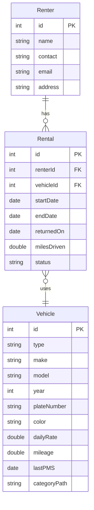

# 2. Entity-Relationship Sketch

## Renter

| Attribute | Key | Description |
|---|---|---|
| `id` | PK | Unique number for each renter. |
| `name` | - | Full name of the renter. |
| `contact` | - | Phone number of the renter. |
| `email` | - | Email address of the renter. |
| `address` | - | Home address of the renter. |

## Vehicle

| Attribute | Key | Description |
|---|---|---|
| `id` | PK | Unique number for each vehicle. |
| `type` | - | SEDAN, SUV, or MOTORCYCLE. |
| `make` | - | Brand of the vehicle (from the NHTSA vPIC API). |
| `model` | - | Model name of the vehicle (from the NHTSA vPIC API). |
| `year` | - | Model year of the vehicle. |
| `plateNumber` | - | License plate number of the vehicle. |
| `color` | - | Color of the vehicle. |
| `dailyRate` | - | Rental price per day. |
| `mileage` | - | Total miles the vehicle has driven so far. |
| `lastPMS` | - | Date of the last preventive maintenance service (PMS). |
| `categoryPath` | - | Category text such as `Car > Sedan > Compact Sedan`, used to build the category tree. |

## Rental

| Attribute | Key | Description |
|---|---|---|
| `id` | PK | Unique number for each rental. |
| `renterId` | FK | Links to `Renter.id` (who rented). |
| `vehicleId` | FK | Links to `Vehicle.id` (what was rented). |
| `startDate` | - | Day the rental starts (rent from). |
| `endDate` | - | Day the vehicle is due back (rent to). |
| `returnedOn` | - | Day the vehicle was actually returned to the rental shop. Empty until it is returned. |
| `milesDriven` | - | Miles driven during this rental (mileage used). |
| `status` | - | `ONGOING` or `RETURNED`. If the vehicle comes back earlier than `endDate`, the status becomes `RETURNED` and the vehicle is available to rent again. |

## Relationships

- **Renter 1:M Rental:** One renter can have many rentals.
- **Vehicle 1:M Rental:** One vehicle can be in many rentals over time.

The Rental table connects a renter to a vehicle. The vehicle type is one of `SEDAN`, `SUV`, or `MOTORCYCLE`.

## Summary

We have 3 entities (Renter, Vehicle, Rental), all saved in SQLite using JDBC with `PreparedStatement`. The waiting-list Queue and the undo Stack are only in memory, not tables. `categoryPath` is a text like `Car > Sedan > Compact Sedan` that we use to build the vehicle category tree. When a vehicle is returned, even earlier than its `endDate`, the rental status becomes `RETURNED` and the vehicle is available to rent again.

## Figure 1: Preliminary ER Sketch of FleetRent (Renter, Rental, Vehicle)

