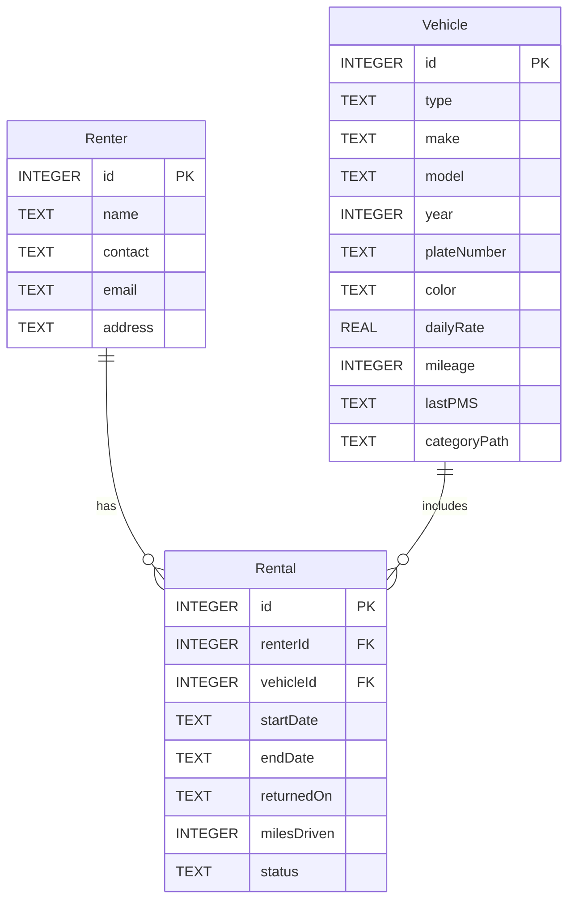
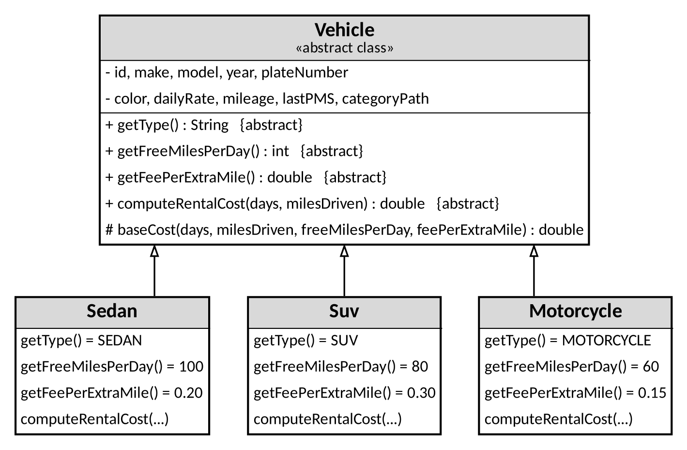
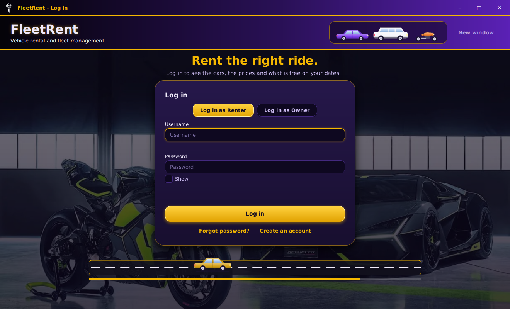
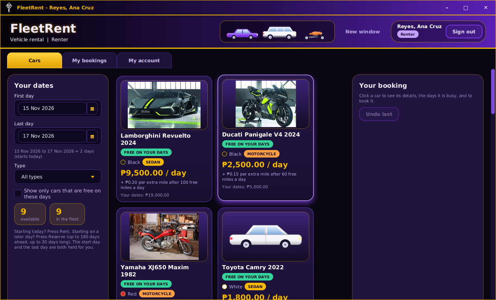
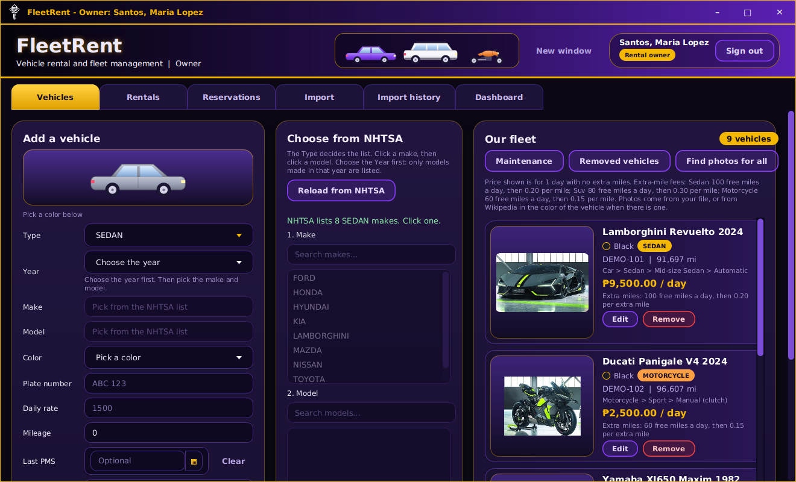
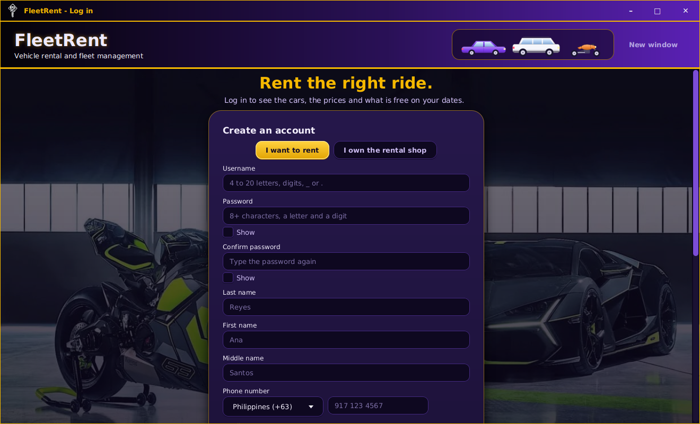
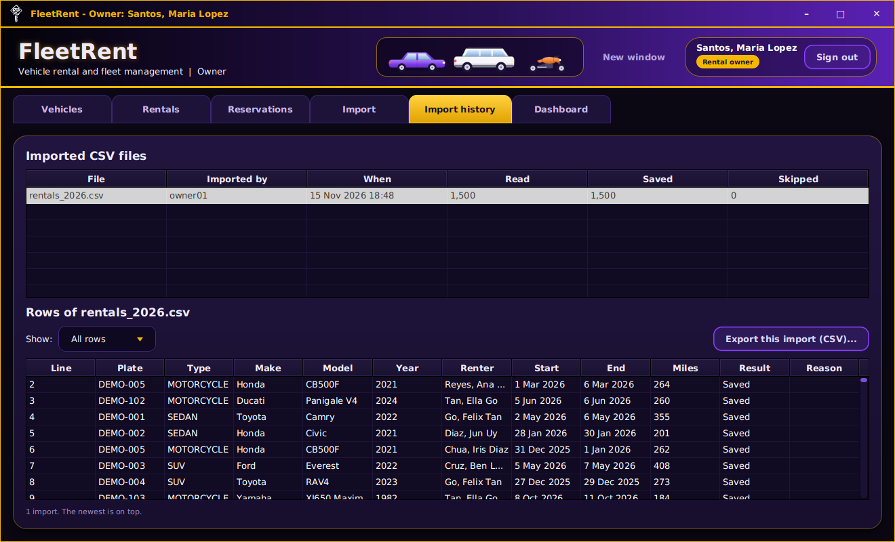
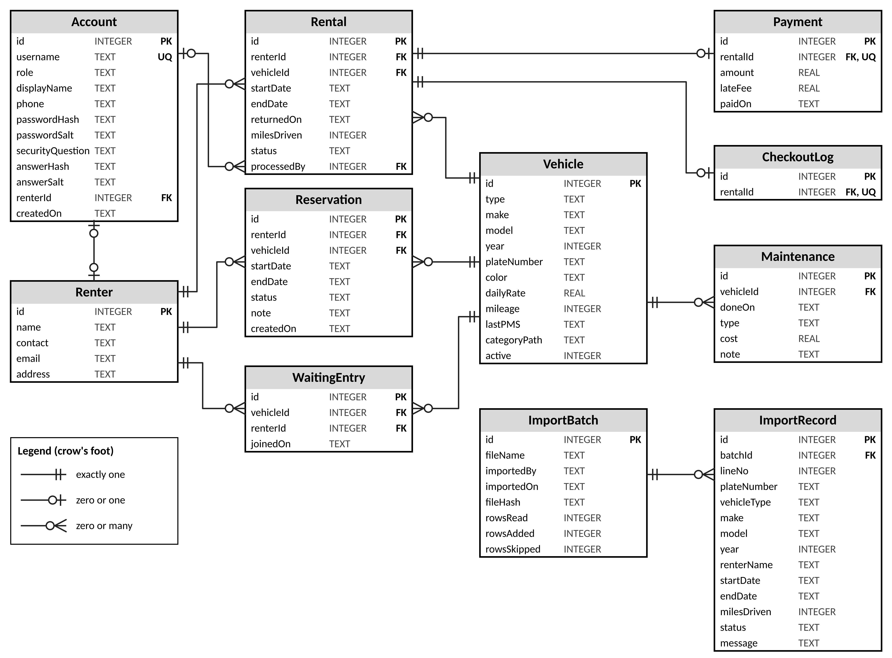
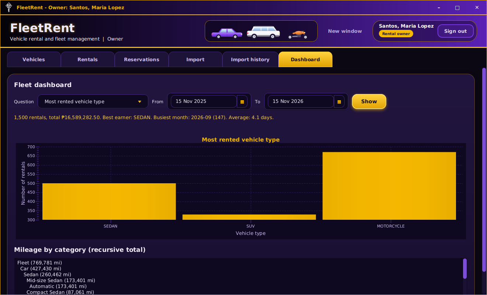
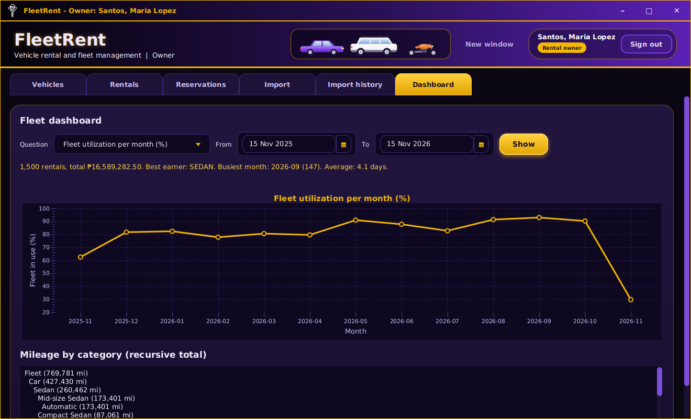

# FleetRent: Vehicle Rental & Fleet Management System

## Project Design Document

CPE 314 - Software Design | University of Cebu Computer Engineering Department | Instructor: Richyll Son | First Semester, S.Y. 2026-2027

| Item                    | Details                                                                           |
| ----------------------- | --------------------------------------------------------------------------------- |
| Group Name / No.        | Group 4                                                                           |
| Members                 | Gabasa, Dexter; Rosal, Wendil; Coloscos, Brent; Lagaya, John Carlo; Labra, Simone |
| Repository URL          | https://github.com/ColoscosBrent/cpe314-69323-capstone-team-04                    |
| Instructor              | Richyll Son                                                                       |
| Term                    | First Semester, S.Y. 2026-2027                                                    |
| Document Version / Date | 0.9 / November 15, 2026 |

## Revision History

| Version | Date | Author | Work |
|---|---|---|---|
| 0.1 | October 21, 2026 | Gabasa | One-paragraph pitch |
| 0.1 | October 21, 2026 | Coloscos | ER sketch |
| 0.1 | October 21, 2026 | Labra | Feature checklist |
| 0.1 | October 21, 2026 | Rosal | Task split |
| 0.1 | October 21, 2026 | Lagaya | Public API, risks and open questions |
| 0.2 | October 27, 2026 | Coloscos | Section 3: class hierarchy and SRP |
| 0.2 | October 27, 2026 | Gabasa | Section 4: ERD and schema |
| 0.3 | November 4, 2026 | Labra | Section 5: API |
| 0.3 | November 4, 2026 | Lagaya | Section 6: concurrency |
| 0.3 | November 4, 2026 | Coloscos | Section 7: data mining and visualization |
| 0.3 | November 4, 2026 | Rosal | Section 8: testing summary |
| 0.4 | November 7, 2026 | Lagaya | Section 3: `RentalDesk` (Rent and Undo rules) |
| 0.4 | November 7, 2026 | Gabasa | Section 4: overlap rule in `Database.insertRental` |
| 0.4 | November 7, 2026 | Coloscos | 1-inch margins |
| 0.5 | November 7, 2026 | Lagaya | Section 3: `RentalService` and `RentalMath` |
| 0.5 | November 7, 2026 | Gabasa | Section 4: how rental overlap is handled |
| 0.5 | November 7, 2026 | Rosal | Section 8: test counts |
| 0.5 | November 7, 2026 | Coloscos | 1-inch margins |
| 0.6 | November 8, 2026 | Coloscos | Sections 1 and 3.1: fee rules |
| 0.6 | November 8, 2026 | Rosal | Section 3.3: accounts and login; Section 8 |
| 0.6 | November 8, 2026 | Lagaya | Section 3.4: booking rules; Section 6: two windows |
| 0.6 | November 8, 2026 | Labra | Section 3.5: the two screens |
| 0.6 | November 8, 2026 | Gabasa | Section 4: Account, Reservation, unique plate |
| 0.7 | November 12, 2026 | Gabasa | Section 4: Payment, Maintenance, WaitingEntry, CheckoutLog |
| 0.7 | November 12, 2026 | Labra | Section 3.5: maintenance window, name in the header |
| 0.7 | November 12, 2026 | Lagaya | Sections 3.4 and 6: saved waiting list and undo |
| 0.7 | November 12, 2026 | Rosal | Sections 8 and 9 |
| 0.7 | November 12, 2026 | Coloscos | Section 3: layered packages, controllers, owner-only rule |
| 0.8 | November 14, 2026 | Gabasa | Section 4: phone column, import tables, new ERD |
| 0.8 | November 14, 2026 | Labra | Section 3.5: login, vehicle form, Import history |
| 0.8 | November 14, 2026 | Rosal | Sections 3.3 and 8 |
| 0.8 | November 14, 2026 | Lagaya | Sections 3.4 and 5.3 |
| 0.8 | November 14, 2026 | Coloscos | Sections 3.6 and 9; final compilation |
| 0.9 | November 15, 2026 | Gabasa | Section 4: DAO classes, `processedBy`, `fileHash`, crow's foot ERD |
| 0.9 | November 15, 2026 | Lagaya | Sections 5 and 6: DTOs, mapper, import Cancel, photo by color |
| 0.9 | November 15, 2026 | Rosal | Sections 3.3, 6 and 8: session rules, controller Tasks, new tests |
| 0.9 | November 15, 2026 | Labra | Section 3.5: themed window with the logo, category suggestion |
| 0.9 | November 15, 2026 | Coloscos | Table of contents, shorter text, Section 9 |

## 1. Introduction & Project Overview

FleetRent is a JavaFX desktop app for small shops that rent out cars, SUVs and motorcycles. It replaces the paper logbook that loses track of which vehicle is out, its mileage and who is next in line. Vehicles, renters and rentals are in one SQLite database. Staff check vehicles out and in, read the rental history and undo the last check-out. A waiting list serves the next customer in order. Make and model come from the NHTSA vPIC API. Every returned rental has a saved payment (with a late fee when late), every vehicle has a maintenance log, and a dashboard shows the most rented vehicle type and how busy the fleet is.

The app has two screens that share one database and one look. Any shop owner can create an owner account (no code) and run the fleet: add, edit and remove vehicles, record rentals and returns, hand over reserved vehicles, import CSV files and read the dashboard. A renter signs up and sees only what a customer needs: the cars with picture, daily rent, extra-mile fee and free dates, with buttons to Rent, Reserve, Undo and join the waiting list. A renter's booking shows for the owner within seconds.

## 2. Preliminary ER Sketch & Team Roles

This is our early sketch: three entities and two relationships. The final ERD with eleven tables is Figure 8 in Section 4. Figure 1 shows the sketch and Tables 1 to 3 list its attributes.



Figure 1: Early draft ER sketch of FleetRent (Renter, Rental, Vehicle); the finalized ERD is Figure 8

### 2.1 Early Entities and Attributes

**Table 1: Renter Entity (Preliminary Attributes)**

| Attribute | Key | Description |
|---|---|---|
| `id` | PK | Unique number of the renter. |
| `name` | - | Full name. |
| `contact` | - | Phone number. |
| `email` | - | Email address. |
| `address` | - | Home address. |

**Table 2: Vehicle Entity (Preliminary Attributes)**

| Attribute | Key | Description |
|---|---|---|
| `id` | PK | Unique number of the vehicle. |
| `type` | - | SEDAN, SUV or MOTORCYCLE. |
| `make` | - | Brand (from NHTSA vPIC). |
| `model` | - | Model name (from NHTSA vPIC). |
| `year` | - | Model year. |
| `plateNumber` | - | License plate number. |
| `color` | - | Color. |
| `dailyRate` | - | Rental price per day. |
| `mileage` | - | Total miles driven so far. |
| `lastPMS` | - | Date of the last preventive maintenance service (PMS). |
| `categoryPath` | - | Category text such as `Car > Sedan > Compact Sedan`, used for the category tree. |

**Table 3: Rental Entity (Preliminary Attributes)**

| Attribute | Key | Description |
|---|---|---|
| `id` | PK | Unique number of the rental. |
| `renterId` | FK | Links to `Renter.id`. |
| `vehicleId` | FK | Links to `Vehicle.id`. |
| `startDate` | - | First day of the rental. |
| `endDate` | - | Day the vehicle is due back. |
| `returnedOn` | - | Day it was returned. Empty until then. |
| `milesDriven` | - | Miles driven during the rental. |
| `status` | - | `ONGOING` or `RETURNED`. A return before `endDate` makes the vehicle free again. |

### 2.2 Relationships

One Renter has many Rentals (1:M), and one Vehicle is in many Rentals over time (1:M). The waiting list and the undo list were not tables in this sketch. The final design saves them (`WaitingEntry`, `CheckoutLog`) and adds `Payment`, `Maintenance`, `Account`, `Reservation`, `ImportBatch` and `ImportRecord` (Section 4).

### 2.3 Team Roster and Primary Roles

**Table 4: Team Roster and Primary Roles (Group 4)**

| Member (GitHub Username) | Role | Primary Responsibility |
|---|---|---|
| Gabasa, Dexter (`gabasad84-afk`) | DB | SQLite tables, JDBC code with `PreparedStatement`, DAO classes, database tests. |
| Rosal, Wendil (`wendilrosalx22`) | ADMIN, QA | Category tree and recursive mileage method, Maven setup, accounts and controllers, tests. |
| Coloscos, Brent (`ColoscosBrent`) | TEAM LEAD, DEVELOPER | Abstract `Vehicle` class, its subclasses, fee rules, package layout, this document. |
| Lagaya, John Carlo (`caloylagaya2k4-pixel`) | DEVELOPER | `Rental`, `Renter`, waiting list Queue, undo Stack, rental services, CSV import, API mapper. |
| Labra, Simone (`simonelabra21`) | UI | JavaFX screens, NHTSA calls on the screens, dashboard charts. |
| **All members** | - | Commit our own work, review each other's pull requests, attend consultations. |

## 3. System Architecture & Object-Oriented Design

The code is in layers. Each layer is a package in `src/main/java/fleetrent/` and calls only the layer below it:

- `ui`: JavaFX screens. They show data and pass clicks to a controller. No SQL and no web calls.
- `controller`: one controller for each group of screens. It runs the work, turns errors into plain messages and checks who may do what (`Session`).
- `service`: the rules (rentals, bookings, accounts, data mining), the API mapper and the web clients.
- `dao`: one DAO class per table. `Database` is the one door to them and owns the connection and the transactions.
- `model` and `dto`: plain data classes, the in-memory structures (waiting list, undo stack, category tree) and the shapes of the JSON answers.
- `app`: `Main` and `App` start the program.

A screen never calls a service directly. Two small pure helpers are the exception: `Validators` (what may be typed) and `RentalMath` (the price estimate). They use no database and no web.

### 3.1 Class Hierarchy



Figure 2: Class hierarchy of FleetRent (Vehicle and its three subclasses)

`Vehicle` is abstract. It holds the shared data (make, model, year, plate, color, daily rate, mileage, last PMS, category path) and four abstract methods: `getType()`, `getFreeMilesPerDay()`, `getFeePerExtraMile()` and `computeRentalCost(days, milesDriven)`. `Sedan`, `Suv` and `Motorcycle` extend it with their own mileage fee (Table 5).

**Table 5: Mileage Fee Rule of Each Vehicle Subclass**

| Subclass | Type text | Free miles per day | Fee per extra mile |
|---|---|---|---|
| Sedan | SEDAN | 100 | 0.20 |
| Suv | SUV | 80 | 0.30 |
| Motorcycle | MOTORCYCLE | 60 | 0.15 |

The renter screen reads these two values, so the text on screen always matches the real rule. The hierarchy is polymorphic: screens and DAOs hold plain `Vehicle` references, and `computeRentalCost(...)` runs the subclass version. `VehicleFactory` makes the right subclass from the type text, or from a `VehicleModelInfo`. Other main classes:

- `Renter`, `Rental`, `RentalStatus`, `Payment`, `Maintenance`: plain data.
- `WaitingList` (Queue, first in first out) and `CheckoutHistory` (Stack, last in first out). Both are saved in `WaitingEntry` and `CheckoutLog` and rebuilt from them.
- `RentalService`: start a rental or join the waiting list, return with payment and late fee, undo.
- `BookingService` and `FleetService`: what a renter may do, and what the owner may do to a vehicle.
- `CategoryNode`: one box of the category tree. Its recursive `totalMileage()` adds a box and everything below it.

### 3.2 Single Responsibility Principle

Each class has one reason to change (SRP). Table 6 gives the one job of each class or group of classes.

**Table 6: SRP Justification for Each Class**

| Class | Its one responsibility | Why this follows SRP |
|---|---|---|
| Vehicle | Shared vehicle data and what every vehicle must do | No saving and no drawing. |
| Sedan, Suv, Motorcycle | The cost rule of one vehicle type | Only a change of that fee rule changes the class. |
| VehicleFactory | Making the right `Vehicle` subclass | A new type changes only this class. |
| CategoryNode | The category tree and the recursive mileage total | Knows categories and mileage only. |
| Renter, Rental, RentalStatus, Payment, Maintenance, MaintenanceType, Reservation, ReservationStatus, BusySpan, Account, Role | The data of one thing | They only store data. |
| WaitingList, CheckoutHistory | The waiting line and the undo stack | Each manages one order only. |
| RentalService | Rental rules: start, return with payment and late fee, undo, waiting | No screen code and no SQL. |
| BookingService, FleetService | The renter's booking rules and the owner's fleet changes | No screen code and no SQL. |
| AuthService, PasswordHasher | Sign up, log in, reset password; hashing | The hasher knows nothing about users. |
| RentalCsvImporter, RentalCsvExporter, CsvLine | Reading and writing the rental CSV | No screen code. |
| VpicClient, CarImageClient, ApiMapper | Calling the web services; turning DTOs into model objects | The client sends and receives; the mapper converts. |
| ModelGuide, PhotoColor | Suggesting the category of a known model; checking the color of a photo | Pure helpers: no screen, no database, no web call. |
| `dto` classes | The shape of one JSON answer | Data only. |
| BaseDao and the table DAOs | The SQL of one table | A table change touches one DAO. |
| Database | The connection, the schema and transactions over several tables | The only door to the DAOs. |
| Session | Who is signed in on this window | Remembers the account and answers "is this the owner?". |
| The controllers (`AuthController`, `VehicleController`, ...) | The jobs of one group of screens | Call services, run slow work as background Tasks, turn errors into messages. |
| ObservableController, TaskRunner | The state every screen controller shares (list, selected row, status, busy); the background Tasks of one window | The screens bind to the state and never build a Task. |
| Guard, ControllerException, RuleException | Turning errors into plain messages | Know nothing about screens or rules. |
| Background | The shared pool of worker threads | Runs work off the screen thread only. |
| AppWindow, ThemedWindow | One window, and its themed title bar | Switch screens and draw the frame; no rules. |
| AuthScreen, AdminView, RenterView | The login, owner and renter screens | Put tabs together; no rules and no SQL. |
| The tabs (`VehicleTab`, `RentalTab`, `RenterBrowseTab`, ...) | One screen each | Show data and pass actions on. |
| SyncPoller, Format | The refresh timer; date and money text | Each does one small job that many screens need. |

### 3.3 Accounts and Login

There are two kinds of account: the **rental owner** (role ADMIN) and the **renter** (role RENTER). Nothing works before a login.

- **Sign up.** Username, password (twice), last, first and middle name, a phone number with its country (Philippines by default) and a security question with an answer. A renter also gives an email and an address (street, city, country). No owner code is needed. A new renter's Renter row and Account row are saved together or not at all.
- **Log in.** The card has **Log in as Renter** and **Log in as Owner**. The message names the problem: wrong username, wrong password or wrong role. This shows whether a username exists (a known limit in `docs/known-issues.md`). After 5 wrong tries a username waits 30 seconds.
- **Forgot password.** Type the username, answer the security question, set a new password. There is no email service in the project.
- **Sign out.** The Sign out button is in every header.
- **Who may do what.** The controllers read the signed-in account from the `Session`. Every owner action (add, edit, remove, restore, maintenance, rent, return, hand over, import) is refused for any other account and for a window with nobody signed in. A renter's own actions use the renter id of the session, never an id sent by the screen. The tabs also hide owner buttons, but the rule does not depend on the screen. There is no clerk role: everyone who is not the owner is treated like a clerk.
- **Undo is per session.** `AuthController` clears the renter's undo stack when a session starts or ends, so the next person on the window never undoes someone else's action.
- **Header.** It shows the signed-in name and a role badge.
- **Passwords.** Never saved as text. `PasswordHasher` saves a PBKDF2 (HMAC-SHA256, 100,000 rounds) hash with a random salt. The security answer is saved the same way.
- **Input rules.** Username: 4 to 20 characters, starts with a letter, letters digits `_` `.`. Password: 8 to 64 characters, no spaces, one letter and one digit. An email must look like `name@example.com` and is always in small letters: a capital letter turns small as it is typed. `PersonName`, `Countries`, `PhoneNumber` and `AddressRules` check the names, the digits of each country's phone number and the address.

### 3.4 Booking Rules, Remove and Edit

A vehicle is free for some days only if it is in the fleet and no ongoing rental or active reservation touches those days. A late rental (last day passed, not returned) still blocks today.

**Table 7: Booking Actions and Their Rules**

| Action | Who | Rule |
|---|---|---|
| See the cars | Renter | Picture, make, model, year, color, daily rent, extra-mile fee and a status for the chosen days: free, rented or reserved. Busy days are shown, never who has the car. |
| Rent | Renter | Starts today, ends on the chosen day (up to 30 days). Refused when the vehicle is not free. |
| Reserve | Renter | Starts tomorrow or later (up to 180 days ahead), up to 30 days long. |
| Undo | Renter | Takes back the last Rent or Reserve, newest first (a Stack). |
| Cancel | Renter | Cancels the renter's own reservation in My bookings. |
| Join and leave the waiting list | Renter | When a vehicle is rented out, the renter joins its line and sees the position. |
| Hand over | Owner | On the start day a reservation becomes a rental. The owner who did it is saved in `Rental.processedBy`. |
| Remove | Owner | Hides a broken vehicle. Its reservations are cancelled and its line is cleared. Refused while it is rented out. History stays. |
| Restore | Owner | Brings a removed vehicle back (refused if its plate is used again). |
| Edit | Owner | Changes everything except the type. |
| Maintenance | Owner | Saves date, type, cost and note. A PMS record moves the last PMS date forward. |
| Return | Owner | Closes the rental and saves a payment: the charge plus a late fee of 10 percent of the daily rate for each late day. |
| Start rental | Owner | If the vehicle is out, the renter joins the waiting line (saved in the database). The owner who did it is saved in `Rental.processedBy`. |

Two windows can never book the same days: the check and the save happen in one transaction (`insertRentalIfFree`, `insertReservationIfFree`).

### 3.5 The Two Screens

Both screens use one style sheet, `fleetrent.css`. Every window has the same themed title bar (`ThemedWindow`) with the FleetRent logo, and every drop-down list and menu has a solid background. `AppWindow` shows the login screen (Figure 3), then the owner or the renter screen.

**Table 8: What the Owner and the Renter Can See**

| | Rental owner | Renter |
|---|---|---|
| Tabs | Vehicles, Rentals, Reservations, Import, Import history, Dashboard | Cars, My bookings, My account |
| Vehicles | All details, plate, mileage, last PMS, maintenance | Picture, make, model, year, color, type, rent, extra-mile fee, status, busy days |
| People | All renters and rentals | Own details and bookings |
| Reservations | All, with Hand over and Cancel | Own, with Cancel and Undo |
| Money and data | Dashboard, CSV import and export, history | Not shown |

The renter screen (Figure 4) shows cars as cards. A click shows the details, the busy days, the price and the Rent, Reserve, Undo and waiting-list buttons. The owner's Vehicles tab (Figure 5) is in the order a person thinks: **Type, Year, then Make and Model.** The Year list runs from now back to 1996, and Make and Model stay locked until a year is chosen, because NHTSA lists models by year. The Color box shows a circle of each color. The Category and Transmission boxes list what fits the type. NHTSA sends only makes and model names, so when a model is clicked the app sets the Category it knows for that model (`ModelGuide`, for example Camry: Mid-size Sedan) and the Transmission box then lists what fits that category. The owner can still change both. The tab has Edit and Remove for every vehicle, a Maintenance window and a Removed vehicles window. The Import tab has **Export all records** (every rental in the app), and the Import history tab has **Export this import** (only the rows of the chosen file).

**Staying in sync.** `SyncPoller` asks every 3 seconds whether anything changed and reloads only then. The question runs as a background Task of the controller, so the window never waits. **Window size.** The window can be resized from 860 x 620 upward and maximized. Large pages get scroll bars, and the title and Sign out button stay visible. `ScreenLayoutTest` checks five sizes on every tab.



Figure 3: Login screen with Log in, Forgot password and Create an account



Figure 4: Renter screen: the cars, their rent and fees, and the booking buttons



Figure 5: Owner screen: Vehicles tab (year first, color list, category and transmission)



Figure 6: Create account with last, first and middle name and a phone number with a country



Figure 7: Owner screen: Import history tab with the files, and the rows of the chosen file

### 3.6 Class Index: Every Class in the Code

Table 9 lists all 125 classes of `src/main/java/fleetrent/`. The other project files are `schema.sql` (the eleven tables), `fleetrent.css`, `pom.xml` and the tests in `src/test/java/fleetrent/` (Section 8).

**Table 9: All Classes of the Code by Package**

| Package | Count | Classes |
|---|---|---|
| `model` | 25 | `Vehicle`, `Sedan`, `Suv`, `Motorcycle`, `VehicleFactory`, `VehicleTypes`, `CategoryNode`, `Account`, `Role`, `Renter`, `Rental`, `RentalStatus`, `Payment`, `Maintenance`, `MaintenanceType`, `Reservation`, `ReservationStatus`, `BusySpan`, `Availability`, `Offer`, `WaitingList`, `CheckoutHistory`, `ImportBatch`, `ImportRecord`, `ImportResult` |
| `dto` | 7 | `VehicleModelInfo`, `VpicResponse`, `VehicleMakeDto`, `VehicleModelDto`, `WikipediaResponse`, `WikipediaPageDto`, `CommonsFileDto` |
| `dao` | 14 | `Database`, `BaseDao`, `RenterDao`, `VehicleDao`, `RentalDao`, `ReservationDao`, `AccountDao`, `PaymentDao`, `MaintenanceDao`, `WaitingEntryDao`, `CheckoutLogDao`, `ImportBatchDao`, `ImportRecordDao`, `DuplicatePlateException` |
| `service` | 26 | `RentalService`, `BookingService`, `FleetService`, `AuthService`, `AuthException`, `PasswordHasher`, `RentalMath`, `RentalCsvImporter`, `RentalCsvExporter`, `ImportStoppedException`, `CsvLine`, `FleetAnalytics`, `VpicClient`, `CarImageClient`, `CarImageStore`, `PhotoFinder`, `PhotoColor`, `ModelGuide`, `ApiMapper`, `Validators`, `PersonName`, `PhoneNumber`, `Countries`, `AddressRules`, `ErrorMessages`, `SampleData` |
| `controller` | 16 | `AppController`, `AuthController`, `VehicleController`, `RentalController`, `ReservationController`, `RenterController`, `ImportController`, `DashboardController`, `ObservableController`, `TaskRunner`, `ChangeWatcher`, `Session`, `Guard`, `ControllerException`, `RuleException`, `Background` |
| `ui` | 35 | `AppWindow`, `ThemedWindow`, `AuthScreen`, `AdminView`, `RenterView`, `VehicleTab`, `FleetListCard`, `NhtsaPicker`, `MaintenanceWindow`, `RemovedVehiclesWindow`, `VehicleListCell`, `ColorCell`, `PhotoJobs`, `RentalTab`, `ReservationTab`, `ImportTab`, `ImportHistoryTab`, `DashboardTab`, `RenterBrowseTab`, `RenterBookingsTab`, `RenterAccountTab`, `Chrome`, `PasswordInput`, `SyncPoller`, `Format`, `NameFields`, `PhoneField`, `AddressFields`, `ValidatedField`, `Layout`, `LoadingRoad`, `CarGraphic`, `VehiclePictures`, `ColorNames`, `UiHelper` |
| `app` | 2 | `App`, `Main` |

## 4. Data Model & Database Design

### 4.1 Finalized ERD

The finalized ERD has eleven tables. Renter, Vehicle and Rental come from the early sketch, now with types and keys. The others:

- **Account**: a login (it also holds the phone number).
- **Reservation**: a vehicle held for future days.
- **Payment**: what was paid for a returned rental (charge, late fee, date).
- **Maintenance**: work done on a vehicle (date, type, cost).
- **WaitingEntry**: a renter in a vehicle's waiting line.
- **CheckoutLog**: check-outs that can still be undone.
- **ImportBatch**: one imported CSV file (name, who, when, hash, rows read, saved, skipped).
- **ImportRecord**: one line of that file, saved or skipped.

The lines use crow's foot marks (see the legend in Figure 8): two short bars mean exactly one, a bar with a circle means zero or one, and a crow's foot with a circle means zero or many. A renter has at most one Account. A Rental has at most one Payment and one CheckoutLog (`rentalId` is unique). A Rental, Reservation or WaitingEntry links one renter to one vehicle through two foreign keys. `Rental.processedBy` links a rental to the owner account that started it.

**Rental overlap.** `RentalService.startRental` puts a renter on the waiting list when the vehicle has an ongoing rental. The `Rental` table has no date check, because the CSV import saves past history in which one vehicle is rented many times (`docs/known-issues.md`, item 17).

**Free days.** `Database.isVehicleFree` says a vehicle is free when it is in the fleet and no ONGOING rental and no ACTIVE reservation touches the days. Rent, Reserve and the owner's Start rental use it inside one transaction.

The waiting list and the undo stack are rebuilt from `WaitingEntry` and `CheckoutLog` each time, so the database is the one source of truth, also with two windows open. The category tree is built from each vehicle's `categoryPath`. A rental is paid once: `Payment.rentalId` is unique and the payment is saved in the same transaction as the return (`Database.saveReturn`).



Figure 8: Finalized ERD of FleetRent (eleven tables)

### 4.2 Schema Description

The database file is `fleetrent.db`. The app creates the tables on the first start with the statements below (also in `src/main/resources/schema.sql`). They match Figure 8. An older `fleetrent.db` keeps its data: at start the app adds the missing columns (`Vehicle.active`, `Account.phone`, `Rental.processedBy`, `ImportBatch.fileHash`) and the missing tables.

```sql
CREATE TABLE IF NOT EXISTS Renter (
    id       INTEGER PRIMARY KEY AUTOINCREMENT,
    name     TEXT NOT NULL,
    contact  TEXT,
    email    TEXT,
    address  TEXT
);
```

```sql
CREATE TABLE IF NOT EXISTS Vehicle (
    id            INTEGER PRIMARY KEY AUTOINCREMENT,
    type          TEXT NOT NULL CHECK (type IN ('SEDAN', 'SUV', 'MOTORCYCLE')),
    make          TEXT NOT NULL,
    model         TEXT NOT NULL,
    year          INTEGER,
    plateNumber   TEXT,
    color         TEXT,
    dailyRate     REAL NOT NULL,
    mileage       INTEGER NOT NULL DEFAULT 0,
    lastPMS       TEXT,
    categoryPath  TEXT,
    active        INTEGER NOT NULL DEFAULT 1
);
```

```sql
CREATE TABLE IF NOT EXISTS Rental (
    id           INTEGER PRIMARY KEY AUTOINCREMENT,
    renterId     INTEGER NOT NULL REFERENCES Renter(id),
    vehicleId    INTEGER NOT NULL REFERENCES Vehicle(id),
    startDate    TEXT NOT NULL,
    endDate      TEXT NOT NULL,
    returnedOn   TEXT,
    milesDriven  INTEGER NOT NULL DEFAULT 0,
    status       TEXT NOT NULL DEFAULT 'ONGOING' CHECK (status IN ('ONGOING', 'RETURNED')),
    processedBy  INTEGER REFERENCES Account(id)
);
```

```sql
CREATE TABLE IF NOT EXISTS Account (
    id               INTEGER PRIMARY KEY AUTOINCREMENT,
    username         TEXT NOT NULL UNIQUE COLLATE NOCASE,
    role             TEXT NOT NULL CHECK (role IN ('ADMIN', 'RENTER')),
    displayName      TEXT NOT NULL,
    phone            TEXT,
    passwordHash     TEXT NOT NULL,
    passwordSalt     TEXT NOT NULL,
    securityQuestion TEXT NOT NULL,
    answerHash       TEXT NOT NULL,
    answerSalt       TEXT NOT NULL,
    renterId         INTEGER REFERENCES Renter(id),
    createdOn        TEXT NOT NULL
);
```

```sql
CREATE TABLE IF NOT EXISTS Reservation (
    id         INTEGER PRIMARY KEY AUTOINCREMENT,
    renterId   INTEGER NOT NULL REFERENCES Renter(id),
    vehicleId  INTEGER NOT NULL REFERENCES Vehicle(id),
    startDate  TEXT NOT NULL,
    endDate    TEXT NOT NULL,
    status     TEXT NOT NULL DEFAULT 'ACTIVE' CHECK (status IN ('ACTIVE', 'CANCELLED', 'CONVERTED')),
    note       TEXT,
    createdOn  TEXT NOT NULL
);
```

```sql
CREATE TABLE IF NOT EXISTS Payment (
    id        INTEGER PRIMARY KEY AUTOINCREMENT,
    rentalId  INTEGER NOT NULL UNIQUE REFERENCES Rental(id) ON DELETE CASCADE,
    amount    REAL NOT NULL CHECK (amount >= 0),
    lateFee   REAL NOT NULL DEFAULT 0 CHECK (lateFee >= 0),
    paidOn    TEXT NOT NULL
);
```

```sql
CREATE TABLE IF NOT EXISTS Maintenance (
    id         INTEGER PRIMARY KEY AUTOINCREMENT,
    vehicleId  INTEGER NOT NULL REFERENCES Vehicle(id),
    doneOn     TEXT NOT NULL,
    type       TEXT NOT NULL CHECK (type IN ('PMS', 'REPAIR', 'TIRES', 'INSPECTION', 'OTHER')),
    cost       REAL NOT NULL DEFAULT 0 CHECK (cost >= 0),
    note       TEXT
);
```

```sql
CREATE TABLE IF NOT EXISTS WaitingEntry (
    id         INTEGER PRIMARY KEY AUTOINCREMENT,
    vehicleId  INTEGER NOT NULL REFERENCES Vehicle(id),
    renterId   INTEGER NOT NULL REFERENCES Renter(id),
    joinedOn   TEXT NOT NULL
);
```

```sql
CREATE TABLE IF NOT EXISTS CheckoutLog (
    id        INTEGER PRIMARY KEY AUTOINCREMENT,
    rentalId  INTEGER NOT NULL UNIQUE REFERENCES Rental(id) ON DELETE CASCADE
);
```

```sql
CREATE TABLE IF NOT EXISTS ImportBatch (
    id           INTEGER PRIMARY KEY AUTOINCREMENT,
    fileName     TEXT NOT NULL,
    importedBy   TEXT,
    importedOn   TEXT NOT NULL,
    fileHash     TEXT,
    rowsRead     INTEGER NOT NULL DEFAULT 0,
    rowsAdded    INTEGER NOT NULL DEFAULT 0,
    rowsSkipped  INTEGER NOT NULL DEFAULT 0
);
```

```sql
CREATE TABLE IF NOT EXISTS ImportRecord (
    id           INTEGER PRIMARY KEY AUTOINCREMENT,
    batchId      INTEGER NOT NULL REFERENCES ImportBatch(id) ON DELETE CASCADE,
    lineNo       INTEGER NOT NULL,
    plateNumber  TEXT,
    vehicleType  TEXT,
    make         TEXT,
    model        TEXT,
    year         INTEGER,
    renterName   TEXT,
    startDate    TEXT,
    endDate      TEXT,
    milesDriven  INTEGER,
    status       TEXT NOT NULL CHECK (status IN ('ADDED', 'SKIPPED')),
    message      TEXT
);
```

```sql
CREATE UNIQUE INDEX IF NOT EXISTS idxVehiclePlate ON Vehicle(UPPER(plateNumber)) WHERE active = 1;
CREATE INDEX IF NOT EXISTS idxRentalVehicle ON Rental(vehicleId, status);
CREATE INDEX IF NOT EXISTS idxReservationVehicle ON Reservation(vehicleId, status);
CREATE INDEX IF NOT EXISTS idxReservationRenter ON Reservation(renterId);
CREATE INDEX IF NOT EXISTS idxMaintenanceVehicle ON Maintenance(vehicleId, doneOn);
CREATE INDEX IF NOT EXISTS idxWaitingVehicle ON WaitingEntry(vehicleId, id);
CREATE INDEX IF NOT EXISTS idxImportRecordBatch ON ImportRecord(batchId, status);
```

Notes on the schema:

- Dates are text in the form `YYYY-MM-DD`, because SQLite has no date type.
- `returnedOn` is NULL until the return. A return before `endDate` sets the status to RETURNED and frees the vehicle.
- The app turns on `PRAGMA foreign_keys = ON`, so a rental cannot point to a missing renter or vehicle.
- `Vehicle.type` is SEDAN, SUV or MOTORCYCLE. `Vehicle.active` is 1 in the fleet and 0 after Remove (the row stays so old rentals keep their vehicle).
- The unique index `idxVehiclePlate` allows a plate (capital letters ignored) once among the vehicles in the fleet. A second one makes the DAO throw `DuplicatePlateException`. If an old file already has duplicates, the index cannot be built; the app then shows a one-time message and checks the plate before saving.
- `Account.username` is UNIQUE and ignores capital letters. `Account.renterId` is empty for an owner. Passwords and security answers are saved only as salted hashes.
- `Rental.processedBy` is the account that started the rental (owner check-out or hand over). It is empty for rentals from a CSV file.
- `Reservation.status` is ACTIVE, CANCELLED or CONVERTED. `Reservation.note` says why it ended.
- `Payment.amount` is the charge (days and extra miles). `Payment.lateFee` is 10 percent of the daily rate for each late day (`RentalMath.LATE_FEE_RATE`). CSV rentals have no Payment row; their cost is worked out from the days and miles.
- `Maintenance.type` is PMS, REPAIR, TIRES, INSPECTION or OTHER. A PMS record moves `Vehicle.lastPMS` forward, never backward, in the same transaction.
- `WaitingEntry` rows are served in `id` order (first in first out). `CheckoutLog` rows are undone from the highest `id` (last in first out). Both are cleaned when their rental or vehicle is deleted.
- Names are saved as `Last, First Middle`, phones as `+63 9171234567`, addresses as `street, city, country`. `Vehicle.categoryPath` holds the full path with the transmission, for example `Motorcycle > Sport > Manual (clutch)`.
- `ImportBatch` has one row per file, with the SHA-256 of the file in `fileHash`. The same file is refused a second time. `ImportRecord` has one row per line (`status` ADDED or SKIPPED, `message` says why). Deleting a batch deletes its records. The screen shows at most 2,000 rows of a file.
- Every JDBC statement with values uses `PreparedStatement` with bound parameters.

**Table 10: Schema Changes Since the First Version**

| Change | Table | Why |
|---|---|---|
| New column `active` | Vehicle | Remove a vehicle and keep its rentals. |
| New table | Account | Owner and renter logins (hashed passwords). |
| New table | Reservation | A renter holds a vehicle for future days. |
| New indexes | Rental, Reservation | Fast free-day checks. |
| New unique index `idxVehiclePlate` | Vehicle | No two fleet vehicles share a plate. |
| New table | Payment | The cost and late fee of a returned rental are saved. |
| New table | Maintenance | A history of work done on a vehicle. |
| New tables | WaitingEntry, CheckoutLog | The waiting list and undo list survive a restart. |
| New column `phone` | Account | Every account has a phone number with its country. |
| New tables | ImportBatch, ImportRecord | The history of every imported CSV file, line by line. |
| New column `processedBy` | Rental | Which owner account started the rental. |
| New column `fileHash` | ImportBatch | The same file cannot be imported twice. |

## 5. API Integration Design

### 5.1 Public APIs Used

FleetRent calls three free public web services. None needs a key, and all run only on background threads (Section 6). Our instructor allowed public APIs outside the course material.

**Table 11: Public APIs Used by FleetRent**

| API | Base address | Used for | Classes |
|---|---|---|---|
| NHTSA vPIC (US National Highway Traffic Safety Administration) | `https://vpic.nhtsa.dot.gov/api` | Official makes and models, so they come from data and not from typing. | `VpicClient`, `VehicleModelInfo` |
| Wikipedia (MediaWiki API) | `https://en.wikipedia.org/w/api.php` | A photo of the car model for the vehicle cards. | `CarImageClient`, `PhotoFinder`, `CarImageStore` |
| Wikimedia Commons (the picture library of Wikipedia, same API) | `https://commons.wikimedia.org/w/api.php` | A photo of the model in the color the owner chose. | `CarImageClient`, `PhotoColor`, `CommonsFileDto` |

NHTSA lists vehicles sold in the United States, so a few models are not sold in the Philippines.

### 5.2 NHTSA vPIC Endpoints

All calls are HTTP GET requests that return JSON. Our types map to NHTSA words: SEDAN to `car`, SUV to `mpv`, MOTORCYCLE to `motorcycle`.

**Table 12: NHTSA vPIC Endpoints Called by FleetRent**

| Endpoint | When we use it |
|---|---|
| `/vehicles/GetMakesForVehicleType/{type}?format=json` | The user picks a Type. It fills the Make list, so a motorcycle make never appears for a Sedan. |
| `/vehicles/GetModelsForMakeYear/make/{make}/modelyear/{year}/vehicleType/{type}?format=json` | The user picks a make. It fills the Model list. The year is chosen first. If NHTSA has no model for that year, the list stays empty and the screen says so. |
| `/vehicles/GetModelsForMake/{make}?format=json` | The dashboard question "NHTSA models per make (live)", once for each make we own. |

### 5.3 Photo Search: Wikipedia and Commons

**Photo in the chosen color first.** When a vehicle is added (or **Find photos for all** is pressed), the app first asks Wikimedia Commons for picture files of "make model color" (`generator=search`, `gsrnamespace=6`, `prop=imageinfo`). A file is used when its name has the make and the model, and its name says the color or its pixels do (`PhotoColor` counts how much of the middle of the picture has that color). This is an estimate.

**The usual photo next.** When no photo in that color is found, the app searches Wikipedia for "year make model" and, if no page matches, for "make model". A page is used only if its title has both the make and the model. Wikipedia has one main picture per model page, so the picture matches the model but may not be of the exact year. With no match, a drawn car is shown.

**Table 13: Main Parts of the Wikipedia Request**

| Parameter | Value | Meaning |
|---|---|---|
| `generator=search`, `gsrsearch` | make and model | Search the pages. |
| `gsrnamespace=0`, `gsrlimit=6` | 0 and 6 | Normal articles only, at most six. |
| `prop=pageimages`, `piprop=thumbnail`, `pithumbsize=800` | thumbnail, 800 pixels | The main picture of each page. |
| `format=json` | json | Answer in JSON. |

`CarImageClient.searchByColor` returns the Commons pictures, and `CarImageClient.findImageUrl` returns the Wikipedia picture address, or nothing. `CarImageClient.download` saves the picture (at most 8 MB, and it must be a JPG, PNG, GIF or BMP). `PhotoFinder` joins the two steps and `CarImageStore` saves the file in `vehicle_images` next to the database.

### 5.4 Shape of the JSON Responses

NHTSA answers one object. We use its `Results` array:

```
{
  "Count": 3,
  "Message": "Response returned successfully",
  "Results": [
    { "Make_ID": 448, "Make_Name": "TOYOTA", "Model_ID": 2208, "Model_Name": "Corolla" }
  ]
}
```

Wikipedia answers an object whose `query.pages` holds one entry per page:

```
{
  "query": {
    "pages": {
      "12345": {
        "title": "Toyota Corolla",
        "index": 1,
        "thumbnail": { "source": "https://upload.wikimedia.org/.../600px-Corolla.jpg" }
      }
    }
  }
}
```

Commons answers in the same outer shape; each entry of `query.pages` is one picture file with a `title`, an `index` and an `imageinfo` list (`thumburl`, `mime`).

Each shape has a DTO class in the `dto` package (Table 14). Gson fills the DTOs with `@SerializedName`.

**Table 14: JSON Shapes and the DTO Classes**

| Service | JSON part | DTO class | Fields we read |
|---|---|---|---|
| NHTSA | whole answer | `VpicResponse` | `Count`, `Message`, `Results` |
| NHTSA makes | `Results[]` | `VehicleMakeDto` | `MakeName` |
| NHTSA models | `Results[]` | `VehicleModelDto` | `Make_Name`, `Model_ID`, `Model_Name` |
| Wikipedia | whole answer | `WikipediaResponse` | `query.pages` |
| Wikipedia | one page | `WikipediaPageDto` | `index`, `thumbnail.source` |
| Commons | one picture file | `CommonsFileDto` | `title`, `index`, `imageinfo[].thumburl`, `imageinfo[].mime` |

### 5.5 How the Data Is Parsed

- `VpicClient` sends the request with `java.net.http.HttpClient` (10 second connect and 30 second request time-out) and reads the JSON into the DTOs with Gson.
- `ApiMapper` turns DTOs into model objects. It makes one `VehicleModelInfo` per model row, skips a row without a model name, removes duplicate makes and sorts. A bad row is skipped. Text that is not valid JSON throws an error with a plain message.
- `CarImageClient.parseThumbnailUrl` keeps the pages that have a thumbnail address starting with `http` and returns the one with the lowest `index`.
- `CarImageClient.parseColorImageUrl` and `parseModelPhotoUrls` keep the Commons pictures of the whole vehicle whose name has the make and the model.
- Invalid JSON, a missing `Results` list or an HTTP status other than 200 is reported as an error, never as a crash.
- `ApiMapperTest`, `VpicClientTest` and `ColorPhotoTest` read saved answers from `src/test/resources`, so no test needs the internet.

### 5.6 How the Data Is Used

- The mapped objects fill the Make and Model lists, so a saved vehicle always has an official make and model that match its type.
- The picked make and model are remembered, so Add vehicle still works when a list reloads. Names are compared without capital letters and extra spaces.
- The dashboard question "NHTSA models per make (live)" calls the API once per make in the fleet.
- The picture is saved on disk and shown on the vehicle cards. The status line says whether it is in the color of the vehicle.
- The picked model name also sets the Category box (`ModelGuide`).
- Nothing from NHTSA is cached: every choice makes a new live call.

### 5.7 When a Service Cannot Be Reached

`ErrorMessages.forApi` shows a red message that says why (no internet, too slow, blocked, server problem). Make and Model can then be typed by hand, and a vehicle without a photo shows a drawn car. The rest of the app keeps working.

## 6. Concurrency Design

### 6.1 Background Operations

Five kinds of work could freeze the window, so each runs off the screen thread.

**Table 15: Long-Running Operations and Where They Run**

| Operation | Where | Why it is slow |
|---|---|---|
| NHTSA make and model lists | `VehicleController.loadMakes`, `loadModels` | Waits for the internet. |
| CSV rental import and export | `ImportController.startImport`, `exportRecordsLater`, `exportImportLater` | Reads or writes a file with thousands of rows (the practice file has 50,000). |
| Car photo search (Commons, Wikipedia) | `VehicleController.findPhotoLater`, `findPhotosLater` | Asks the web services and downloads pictures. |
| Live dashboard question | `DashboardController.countModels` | One API call for each make in the fleet. |
| Refreshing a tab | `refresh` methods of the controllers, `AppController.changes` (for `SyncPoller`) | Reads lists from the database, which can wait for a lock during an import. |

### 6.2 Threading Approach

- Slow work is a JavaFX `Task`. **The controllers build and run the Tasks, not the screens.** Every screen controller extends `ObservableController`, which has an observable list of rows, the selected row, a status text and a busy flag. A screen binds its controls to them and calls a method such as `refresh()`.
- `ObservableController.runTask` hands the Task to the `TaskRunner` of the window, which runs it on `Background`, one shared fixed pool of 4 daemon threads (`fleetrent-worker-1` to `-4`) for every tab and window. Extra jobs wait in line. `App.stop` shuts the pool down.
- When a Task ends, `setOnSucceeded` or `setOnFailed` runs on the JavaFX Application Thread, so it can change labels, lists and charts.
- When two reads of the same kind overlap, only the newest result is shown (each kind of read has a slot with a ticket number).
- `TaskRunner` remembers the running jobs of a window. A closing window cancels them and waits (at most 4 seconds) before it closes its database connection, so a job never meets a closed connection.
- The import reports progress with `Platform.runLater`. The **Cancel import** button calls `ImportController.cancelImport`, which stops it at the next line. Rows saved before are kept, and the history shows the real counts.
- The background import and the screen use the same SQLite connection of their window, so every `Database` method is `synchronized`. The import saves in batches of 100.

**Table 16: Where Each Kind of Work Runs**

| Work | Thread |
|---|---|
| Drawing the window, handling clicks, showing results | JavaFX Application Thread |
| NHTSA, Wikipedia and Commons calls, CSV import and export, live dashboard question, tab refresh, `SyncPoller` reads | Shared pool (`fleetrent-worker-N`) |
| Hashing a password at log in or sign up | The caller; about a tenth of a second on purpose |

### 6.3 Two Windows, One File

- The owner and a renter can each have a window (the New window button).
- Each window has its own connection to `fleetrent.db` with `PRAGMA busy_timeout = 5000`, so a write waits up to 5 seconds and does not fail while the other window writes.
- Checking that a vehicle is free and saving the booking happen in one transaction that starts with `BEGIN IMMEDIATE`, so two windows cannot book the same days.
- Screens reload only when `Database.changeStamp` says that data changed.
- The waiting list and the undo list are database rows, so a second window sees the same line.

### 6.4 How the UI Stays Responsive

- The Application Thread only draws the window and handles clicks.
- While a Task runs, its button is disabled and a `ProgressBar` shows (endless for API calls, 0 to 100 percent for the import).
- The user can change tabs or type while the work continues.
- If the work fails, a plain message shows and the button works again.
- If the user changes the choice while a request runs, the old answer is ignored when it arrives.

## 7. Data Mining & Visualization Design

### 7.1 Data Analyzed

The Dashboard tab mines the saved rentals (typed or imported) and the vehicle table. Only RETURNED rentals count, because only they have a final cost. `FleetAnalytics` does the calculations and has no screen code. The user picks a question and a From and To date, and every number is calculated again from the database.

### 7.2 Aggregation and Frequency Steps

**Table 17: Dashboard Questions and Their Mining Steps**

| Question | Mining step | Chart |
|---|---|---|
| Most rented vehicle type | Count of returned rentals per type. | Bar |
| Fleet utilization per month (%) | Rented vehicle-days divided by (vehicles x days of the month that count), times 100. Only the days inside the chosen dates and up to today count. | Line |
| Revenue by vehicle type | Sum of `computeRentalCost` of each rental, per type. | Bar |
| Rentals per month | Count of rentals per year and month. | Line |
| Top 5 rented models | Count per make and model, sorted, cut to 5. | Bar |
| NHTSA models per make (live) | Number of models NHTSA lists for each make we own. | Bar |

### 7.3 Summary Line and Recursive Total

- A summary line shows the rentals, total revenue, best earning type, busiest month and average rental length, with thousands separators and the peso sign.
- The recursive `CategoryNode.totalMileage` totals the mileage of the category tree (Fleet > Car > Sedan) and shows it under the chart.

### 7.4 Charts and Why We Chose Them

Both JavaFX charts have a title, labeled axes and one series. They redraw when the question or the dates change. The y-axis does not have to start at zero, so small differences between bars stay visible.

**Table 18: Chart Types and Why We Chose Them**

| Chart | Used for | Why this chart |
|---|---|---|
| `BarChart` | Rentals per type, revenue per type, top models, models per make | Separate groups; bars make the differences easy to see. |
| `LineChart` | Utilization per month, rentals per month | Change over time; a line shows the rise and fall. |

We do not use a pie chart, because 12 months or many models are hard to read in one. Figures 9 and 10 show one chart of each type with sample data.



Figure 9: Dashboard bar chart: most rented vehicle type (sample data)



Figure 10: Dashboard line chart: fleet utilization per month (sample data)

## 8. Testing Summary

There are 550 JUnit 5 tests in 63 test classes. They run with `mvn test` and all pass (0 failures, 0 errors). Database tests use an in-memory SQLite database (or a temporary file when several connections are needed). API tests read saved JSON answers or use a small fake web server on the same computer, so no test needs the internet. The tests cover:

- empty and null input, and the exact limits of every input rule;
- missing rows, bad links between tables and half-saved data;
- a corrupt, damaged or locked database file, and an old database that is upgraded;
- strange text (quotes, semicolons, other languages);
- a renter trying an owner job, and two windows booking the same car at the same moment.

**Table 19: JUnit Tests by Area**

| Area | Test classes | Tests |
|---|---|---|
| Model classes: vehicles, Rental, Renter, Payment, Maintenance, Queue and Stack, category tree, vehicle types, factory | `VehicleCostTest`, `VehicleSubclassTest`, `VehicleFactoryModelInfoTest`, `RentalTest`, `RenterTest`, `PaymentAndMaintenanceTest`, `QueueStackTest`, `WaitingListCheckoutHistoryTest`, `CategoryNodeTest`, `VehicleTypesTest` | 46 |
| Rentals, returns, late fee, billable days | `RentalMathTest`, `RentalServiceTest`, `RentalEdgeCaseTest` | 32 |
| Database: tables, DAO classes, upgrade of an old file, two windows, booking races, saved lists | `DatabaseTest`, `DatabaseRentalTest`, `DatabaseSyncTest`, `DatabaseEdgeCaseTest`, `DatabaseNewTablesTest`, `DatabasePersistenceTest`, `ConcurrentBookingTest`, `DaoClassesTest`, `DatabaseUpgradeTest` | 70 |
| Database failures: bad input, corrupt and locked files | `DatabaseFailureTest`, `DatabaseFileFailureTest` | 9 |
| Start-up, the owner-only rule and the session rules | `MainTest`, `OwnerOnlyTest`, `SessionRulesTest` | 24 |
| Controllers: observable list, selected row, status, busy flag, background Tasks | `ObservableStateTest` | 6 |
| Accounts and login | `PasswordHasherTest`, `AuthServiceTest`, `AuthEdgeCaseTest` | 47 |
| Renter booking, waiting list, remove and edit | `BookingServiceTest`, `BookingEdgeCaseTest`, `FleetServiceTest`, `FleetEdgeCaseTest`, `RenterWaitingListTest` | 89 |
| CSV import, export of all records and of one import, history, cancel, duplicate file and duplicate rows, demo data | `RentalCsvImporterTest`, `CsvLineTest`, `ImportHistoryAndExportTest`, `ImportControllerTest`, `ImportSafetyTest`, `ImportSafetyControllerTest`, `SampleDataTest` | 42 |
| Name, phone and address rules | `PersonNameTest`, `CountriesTest`, `PhoneNumberTest`, `AddressRulesTest` | 17 |
| NHTSA and Wikipedia code, DTO mapper | `VpicClientTest`, `CarImageClientTest`, `CarImageStoreTest`, `ApiMapperTest` | 50 |
| Photo in the chosen color (Commons), category of a known model | `ColorPhotoTest`, `PhotoColorTest`, `ModelGuideTest` | 23 |
| Data mining | `FleetAnalyticsTest` | 20 |
| Input rules (also the email rule), error messages, colors | `ValidatorsTest`, `ValidatorsEdgeCaseTest`, `ErrorMessagesTest`, `ColorNamesTest` | 37 |
| Unique plate rule and shared thread pool | `DuplicatePlateTest` | 6 |
| Screens: click-through, title bar and logo, window size, drop-down background | `ScreenFlowTest`, `ScreenLayoutTest`, `DropdownThemeTest` | 32 |

**The screens are tested.** `ScreenFlowTest` opens the real login, owner and renter screens and clicks through them: wrong password, the Owner or Renter choice, forgot password, sign up, an email typed in capital letters, Rent, Undo, Reserve, Cancel, Sign out, the vehicle form (Year first, no future year, Make locked until a year is chosen, the category that follows the picked model), Edit and Remove, and a car removed in another window. `ScreenLayoutTest` checks the themed title bar and its logo, the security-question prompt, that the Log in button does not move when an error shows, and that the window fits five sizes from 860 x 620 to 2560 x 1400 on every tab. `DropdownThemeTest` checks that every drop-down and menu has a solid background. The tests use a temporary database and a fake NHTSA server, never `fleetrent.db`. On a computer with no display the 34 tests that need a window (`ScreenFlowTest`, `ScreenLayoutTest`, `ObservableStateTest`) are skipped, not failed, and the other 516 still run. The same checks are on a paper list in `docs/manual-test-checklist.md`.

**What the tests found and we fixed.**

- Two windows saving a booking at the same moment could fail with "database is locked". Writes that check first now begin with `BEGIN IMMEDIATE`, so the second window waits and then sees the days are taken.
- The owner's Start rental uses the same check-and-save as Rent, so an owner and a renter cannot double-book.
- The edit form refuses an empty make, model or plate, a rate of 0 and a negative mileage, even if the screen check is skipped.
- A CSV saved by Excel with an invisible mark at the start is read correctly.
- A failed import keeps the real counts in its history. A cancelled import keeps the rows saved so far.
- The undo of a renter no longer carries over to the next person on the same window.
- An old database upgrades itself: the new columns and tables are added and the data stays.
- At the smallest window size the header is no longer pushed out by a wide tab.
- Importing the same rentals again (an exported file, or the same rows in another file) no longer doubles the data: a rental that is already saved is skipped and listed.
- On a computer with no display the screen tests waited forever. They now skip themselves.
- The utilization of a month that is cut by the chosen dates, or is not over yet, was divided by the whole month. It is now divided by the days that count.

## 9. Individual Contributions

Table 20 lists each member's main area and main classes in the final code. Every change is in the commits and pull requests of the repository.

**Table 20: Individual Contributions**

| Member | Area | Main work in the final code |
|---|---|---|
| Gabasa, Dexter | Database | The eleven tables and `schema.sql`, `BaseDao` and the table DAOs, the `Database` door with its transactions, the upgrade of old files, `processedBy` and `fileHash`, the crow's foot ERD, database tests. |
| Rosal, Wendil | Admin and QA | Accounts and the session rules (`Session`, `AuthController`), the controllers with their observable state and background Tasks (`ObservableController`, `TaskRunner`), `PasswordHasher`, the rules for names, phones, emails, countries and addresses, the category tree, Maven setup, the test plan and Section 8, known issues, requirements map and review response. |
| Coloscos, Brent | Team lead and developer | `Vehicle` and its subclasses, fee rules, the package layout, `pom.xml` (`javafx:run`), this document, the slides, merging the pull requests. |
| Lagaya, John Carlo | Developer | `Rental`, `Renter`, `WaitingList`, `CheckoutHistory`, `RentalService`, the renter waiting list, the CSV import and export (cancel, duplicate file and rows, export of one import), the DTOs and `ApiMapper`, the photo search by color (`PhotoColor`), `ModelGuide`, `FleetAnalytics`, demo data. |
| Labra, Simone | UI | The JavaFX screens: login, sign up, owner tabs, renter screen, maintenance and removed-vehicle windows, the themed window with the logo, the drop-downs, the category suggestion in the vehicle form, dashboard charts, the screen tests. |

### 9.1 Commits and Pull Requests

The Milestone 2 work went into `project/milestone-2` in 22 pull requests (#36 to #57), each merged with a merge commit, and then into `main`. The final round was added to the Week 11 branch in five pull requests, one per step (Gabasa, Lagaya, Rosal, Labra, Coloscos), each merged with a merge commit; the Week 11 pull request (#58) then went into `main`. Every member committed from their own GitHub account. Table 21 counts the non-merge commits of each member (`git shortlog -sne --no-merges`, with the spellings of one person added together).

**Table 21: Commits per Member**

| Member | Before the final round | Final round | Total |
| --- | --- | --- | --- |
| Gabasa, Dexter | 62 | 8 | 70 |
| Rosal, Wendil | 45 | 8 | 53 |
| Coloscos, Brent | 88 | 6 | 94 |
| Lagaya, John Carlo | 48 | 7 | 55 |
| Labra, Simone | 52 | 8 | 60 |

## Appendix

### A.1 References and Links

**Table 22: References and Links**

| Item | Link |
|---|---|
| Project repository | https://github.com/ColoscosBrent/cpe314-69323-capstone-team-04 |
| NHTSA vPIC API documentation | https://vpic.nhtsa.dot.gov/api/ |
| Wikipedia and Wikimedia Commons (MediaWiki Action API) | https://www.mediawiki.org/wiki/API:Main_page |
| Database schema | `src/main/resources/schema.sql` |
| Known issues, requirements map, review response | `docs/known-issues.md`, `docs/requirements-map.md`, `docs/review-response.md` |
| Manual test checklist | `docs/manual-test-checklist.md` |

### A.2 Libraries and Licensing Notes

**Table 23: Libraries Used and Their Licenses**

| Library | Version | Use | License |
|---|---|---|---|
| JavaFX (OpenJFX) | 21.0.4 | Screens and charts | GPL v2 with Classpath Exception |
| sqlite-jdbc | 3.46.1.0 | SQLite access | Apache License 2.0 |
| Gson | 2.10.1 | Reading JSON | Apache License 2.0 |
| JUnit 5 | 5.10.2 | Tests | Eclipse Public License 2.0 |

NHTSA vPIC data comes from a US government service that needs no key. Pictures are downloaded from Wikipedia and Wikimedia Commons only to show a vehicle in the app; each picture keeps the license of its own Wikipedia or Wikimedia Commons page.
