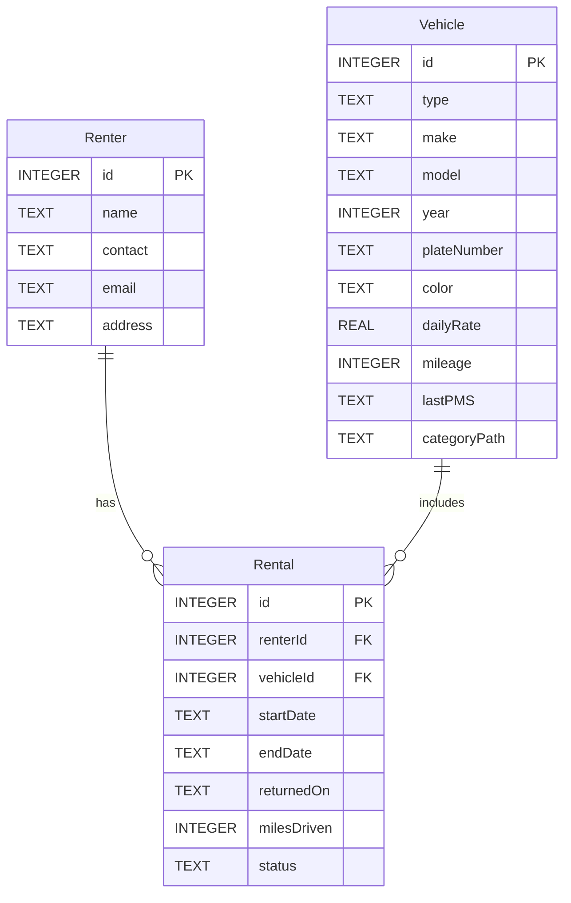
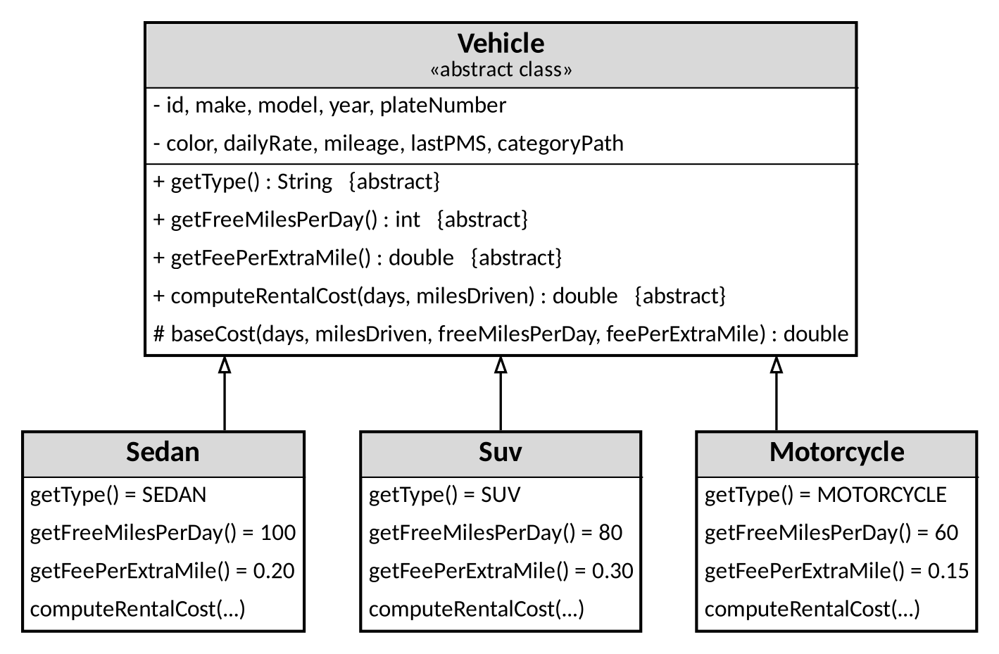
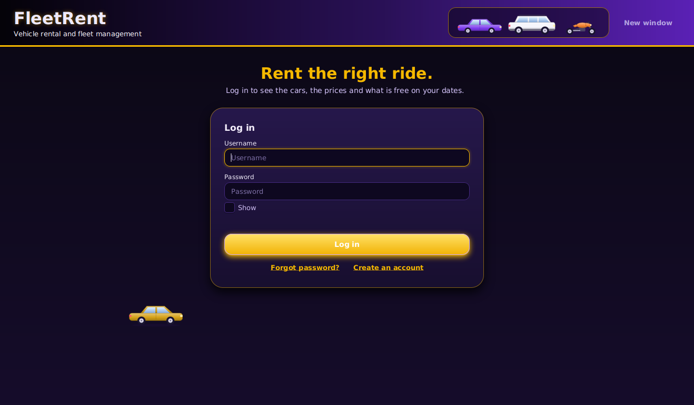
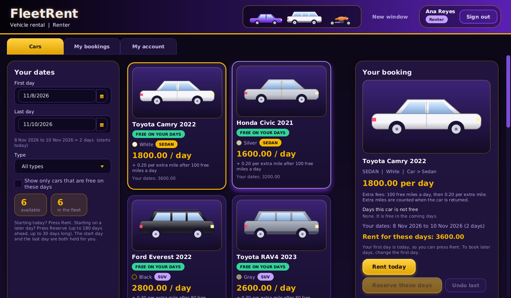
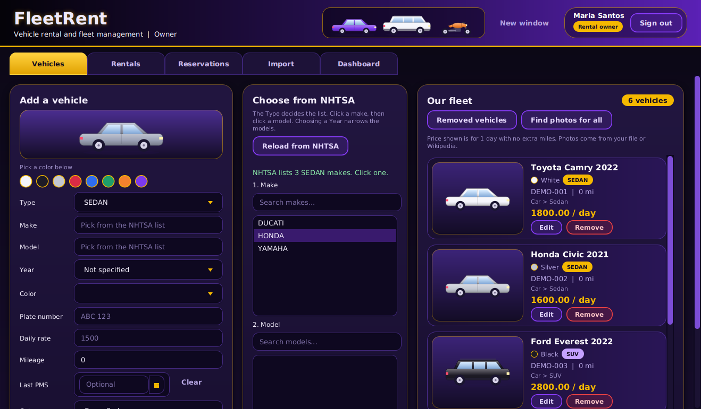
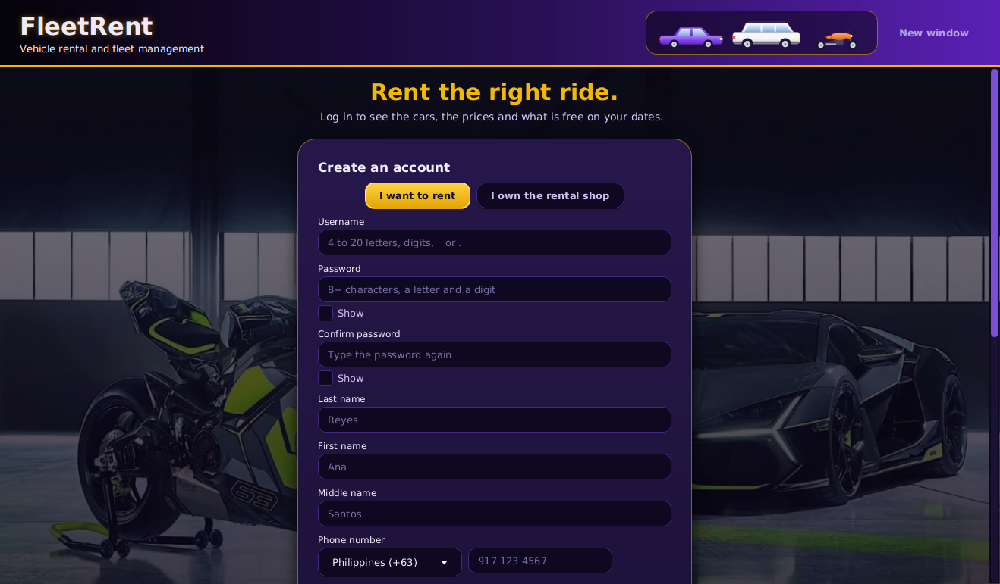
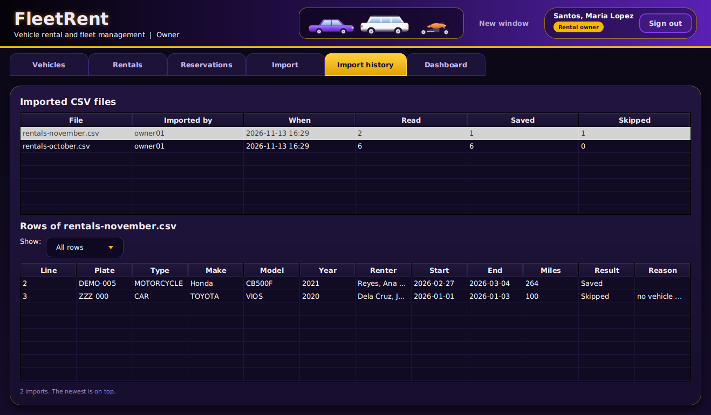
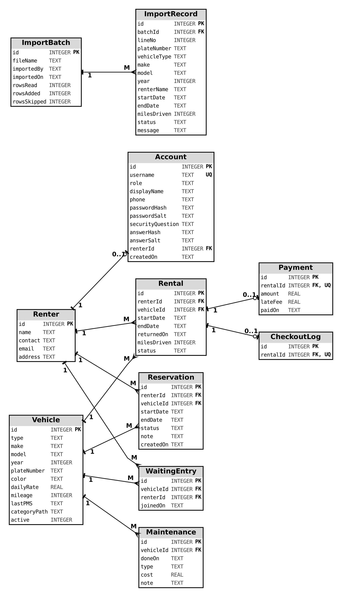
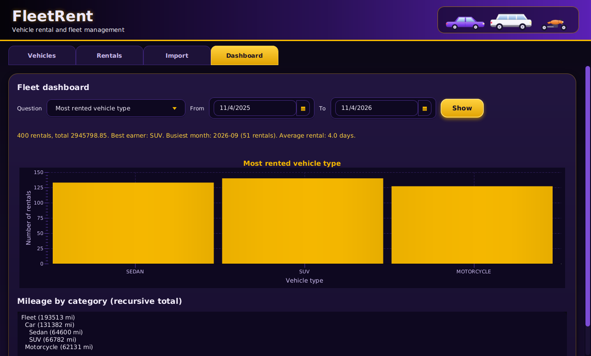
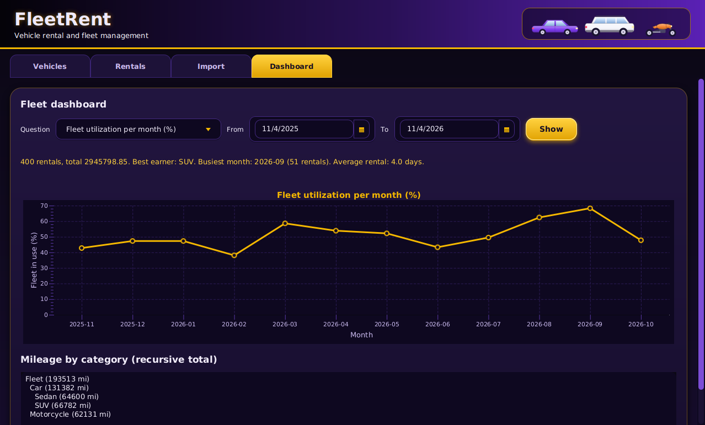

# FleetRent: Vehicle Rental & Fleet Management System

## Project Design Document

CPE 314 - Software Design | University of Cebu Computer Engineering Department | Instructor: Richyll Son | First Semester, S.Y. 2026-2027

| Item                    | Details                                                                           |
| ----------------------- | --------------------------------------------------------------------------------- |
| Group Name / No.        | Group 4                                                                           |
| Members                 | Gabasa, Dexter; Rosal, Wendil; Coloscos, Brent; Lagaya, John Carlo; Labra, Simone |
| Repository URL          | https://github.com/ColoscosBrent/cpe314-69323-capstone-team-04                    |
| Instructor              | Richyll Son                                                                       |
| Term                    | First Semester, S.Y. 2026-2027                                                    |
| Document Version / Date | 1.0 / November 14, 2026 |

## Revision History


| Version | Date | Author | Changes |
|---|---|---|---|
| 0.1 | October 21, 2026 | Gabasa - One Paragraph Pitch; Coloscos - ER Sketch; Labra - Feature Checklist; Rosal - Task split; Lagaya – Public API and Risks/Open questions | Initial draft: Sections 1 to 6 |
| 0.2 | October 27, 2026 | Coloscos - Section 3 (Class Hierarchy and SRP); Gabasa - Section 4 (ERD and Schema) | Sections 3 and 4 added |
| 0.3 | November 7, 2026 | Lagaya - Section 3 (RentalDesk); Gabasa - Section 4 (overlap rule); Coloscos - 1-inch margins | Added `RentalDesk` (Rent and Undo rules), the overlap rule in `Database.insertRental`, and the 1-inch margins |
| 0.4 | November 4, 2026 | Labra - Section 5 (API); Lagaya - Section 6 (Concurrency); Coloscos - Section 7 (Data Mining & Visualization); Rosal - Section 8 (Testing Summary) | Sections 5, 6, 7 and 8 added |
| 0.5 | November 7, 2026 | Lagaya - Section 3 (RentalService, RentalMath); Gabasa - Section 4 (how rental overlap is handled); Rosal - Section 8 (test counts); Coloscos - 1-inch margins | Section 3 and Section 4 keep everything from the first version and add `RentalService`, `RentalMath` and how rental overlap is handled; Section 8 compares the test counts; 1-inch margins |
| 0.6 | November 8, 2026 | Coloscos - Section 1, Section 3.1 (fee rules); Rosal - Section 3.3 (accounts and login), Section 8 (tests); Lagaya - Section 3.4 (booking rules), Section 6 (two windows); Labra - Section 3.5 (the two screens); Gabasa - Section 4 (ERD and schema) | Owner and renter accounts (sign up, log in, forgot password, sign out), a separate renter screen with Rent, Reserve and Undo, Remove and Edit vehicle, the NHTSA make and model fix, an ERD with Account and Reservation, a database rule for unique plate numbers, one shared thread pool, the Wikipedia photo search in Section 5, and a cleaned-up document. Everything from the earlier versions is kept. |
| 0.7 | November 12, 2026 | Gabasa - Section 4 (Payment, Maintenance, WaitingEntry and CheckoutLog tables); Labra - Section 3.5 (maintenance window, signed-in name in the header); Lagaya - Section 3.4 and Section 6; Rosal - Section 8 and Section 9; Coloscos - Section 3 (packages and controllers, owner-only rule) | The code is split into the packages model, dto, dao, service, controller, ui and app, with a controller layer; new tables Payment and Maintenance; the waiting list and the undo list are saved in the database; only the owner can remove or restore a vehicle; named constants and more tests. |
| 1.0 | November 14, 2026 | Gabasa - Section 4 (phone column, ImportBatch and ImportRecord tables, ERD); Labra - Section 3.5 (login, vehicle form, Import history tab); Rosal - Section 3.3 and Section 8; Lagaya - Section 3.4 and Section 5.3; Coloscos - Section 3.6 and Section 9 | Final version: no owner code, so any rental shop owner can sign up; names, phone with country and address are asked at sign-up; the login says which part is wrong and has an Owner or Renter choice, a photo background and moving cars; the vehicle form asks for the year first and lists every style and transmission; CSV import has 13 columns and an Import history tab; two new tables (eleven in all); a redrawn ER sketch and ERD; an Appendix; final compilation and polish. |

## 1. Introduction & Project Overview

FleetRent is a JavaFX desktop app that helps small shops renting out cars, SUVs, and motorcycles replace their paper logbooks, which make it easy to lose track of which vehicle is out, its mileage, and who is next in line. It stores vehicles, renters, and rentals in one SQLite database, so staff can check vehicles out and in, look up rental history, and undo the last check-out. When a vehicle is already rented, a waiting list serves the next customer in order, and verified make and model data comes from the NHTSA vPIC API. Every returned rental gets a saved payment (with a late fee when it is late), every vehicle has a maintenance log, and a dashboard shows the most rented vehicle type and how busy the fleet is over time.

FleetRent has two screens that share one database and one look. Any rental shop owner can create an owner account (no invitation code) and run the fleet: add, edit and remove vehicles, record rentals and returns, hand over reserved vehicles, and read the dashboard. A renter signs up with a full name, phone number, email and address, and sees only what a customer needs: the cars with their picture, daily rent, extra-mile fee and whether they are free on the chosen dates, with buttons to Rent, Reserve or Undo. Both screens read the same file, so a renter's booking shows up for the owner within seconds.


## 2. Preliminary ER Sketch & Team Roles

This is our early ER sketch: three entities (Renter, Vehicle, Rental) and two relationships. It shows where the design started; the finalized ERD with all eleven tables is Figure 8 in Section 4. Figure 1 shows how the three entities connect, and Tables 1 to 3 list their attributes.



Figure 1: Early draft ER sketch of FleetRent (Renter, Rental, Vehicle); the finalized ERD is Figure 8

### 2.1 Early Entities and Attributes


**Table 1: Renter Entity (Preliminary Attributes)**

| Attribute | Key | Description |
|---|---|---|
| `id` | PK | Unique number for each renter. |
| `name` | - | Full name of the renter. |
| `contact` | - | Phone number of the renter. |
| `email` | - | Email address of the renter. |
| `address` | - | Home address of the renter. |

**Table 2: Vehicle Entity (Preliminary Attributes)**

| Attribute | Key | Description |
|---|---|---|
| `id` | PK | Unique number for each vehicle. |
| `type` | - | SEDAN, SUV, or MOTORCYCLE. |
| `make` | - | Brand of the vehicle (from the NHTSA vPIC API). |
| `model` | - | Model name of the vehicle (from the NHTSA vPIC API). |
| `year` | - | Model year of the vehicle. |
| `plateNumber` | - | License plate number of the vehicle. |
| `color` | - | Color of the vehicle. |
| `dailyRate` | - | Rental price per day. |
| `mileage` | - | Total miles the vehicle has driven so far. |
| `lastPMS` | - | Date of the last preventive maintenance service (PMS). |
| `categoryPath` | - | Category text such as `Car > Sedan > Compact Sedan`, used to build the category tree. |

**Table 3: Rental Entity (Preliminary Attributes)**

| Attribute | Key | Description |
|---|---|---|
| `id` | PK | Unique number for each rental. |
| `renterId` | FK | Links to `Renter.id` (who rented). |
| `vehicleId` | FK | Links to `Vehicle.id` (what was rented). |
| `startDate` | - | Day the rental starts (rent from). |
| `endDate` | - | Day the vehicle is due back (rent to). |
| `returnedOn` | - | Day the vehicle was actually returned to the rental shop. Empty until it is returned. |
| `milesDriven` | - | Miles driven during this rental (mileage used). |
| `status` | - | `ONGOING` or `RETURNED`. If the vehicle comes back earlier than `endDate`, the status becomes `RETURNED` and the vehicle is available to rent again. |

### 2.2 Relationships

One Renter can have many Rentals (1:M), and one Vehicle can be in many Rentals over time (1:M). The Rental table connects a renter to a vehicle.

In this early plan the waiting list and the undo list were not tables. The final design saves them (`WaitingEntry` and `CheckoutLog`) and adds `Payment`, `Maintenance`, `Account` and `Reservation` (Section 4).

### 2.3 Team Roster and Primary Roles

Each member has one role and one main job.

**Table 4: Team Roster and Primary Roles (Group 4)**

| Member (GitHub Username) | Role | Primary Responsibility |
|---|---|---|
| Gabasa, Dexter (`gabasad84-afk`) | DB | Database: SQLite tables for vehicles, renters, and rentals, and the JDBC code with `PreparedStatement`. Database tests. |
| Rosal, Wendil (`wendilrosalx22`) | ADMIN, QA | Vehicle category tree and the recursive fleet mileage method. Maven project setup. Tests for these. |
| Coloscos, Brent (`ColoscosBrent`) | TEAM LEAD, DEVELOPER | Domain model and OOD: abstract `Vehicle` class, its three subclasses, and the rate and fee logic. Tests for these. |
| Lagaya, John Carlo (`caloylagaya2k4-pixel`) | DEVELOPER | Rental and Renter classes, the waiting list Queue, the undo Stack, and the CSV import on a background thread. Tests for these. |
| Labra, Simone (`simonelabra21`) | UI | NHTSA vPIC API: sending requests and parsing JSON. JavaFX GUI (forms, buttons, dashboard) and the bar and line charts. |
| **All members** | - | Commit our own work to the team repo, review each other's pull requests, and attend the consultations with the instructor. |

## 3. System Architecture & Object-Oriented Design

FleetRent is built in layers, and each layer is its own package in `src/main/java/fleetrent/`. A layer only calls the layer below it:

- `ui` (JavaFX screens): shows data and passes clicks to a controller. It has no SQL, no `java.sql` and no web calls.
- `controller`: one controller for each part of the screens (accounts, vehicles, rentals, reservations, renter bookings, import, dashboard). It runs the work, turns every error into a plain message, and decides who is allowed to do what (`Session`). `AppController` builds everything for one window.
- `service`: the rules (rentals, bookings, the fleet, accounts, data mining) and the web clients. No screen code.
- `dao`: the `Database` class, the only place with SQL.
- `model` and `dto`: plain data classes (vehicles, renters, rentals, payments, maintenance, reservations, accounts) and the in-memory structures (waiting list, undo stack, category tree).
- `app`: `Main` and `App`, which start the program.

A screen never writes SQL and never calls a service directly; it goes through a controller. The one exception is two small pure helpers in `service`, `Validators` (what may be typed in a field) and `RentalMath` (the price estimate), which use no database and no web.

### 3.1 Class Hierarchy



Figure 2: Class hierarchy of FleetRent (Vehicle and its three subclasses)

`Vehicle` is an abstract class. It holds the data every vehicle has (make, model, year, plate number, color, daily rate, mileage, last PMS date, category path) and four abstract methods: `getType()`, `getFreeMilesPerDay()`, `getFeePerExtraMile()` and `computeRentalCost(days, milesDriven)`. `Sedan`, `Suv`, and `Motorcycle` extend it, each with its own mileage fee rule (Table 5):

**Table 5: Mileage Fee Rule of Each Vehicle Subclass**

| Subclass | Type text | Free miles per day | Fee per extra mile |
|---|---|---|---|
| Sedan | SEDAN | 100 | 0.20 |
| Suv | SUV | 80 | 0.30 |
| Motorcycle | MOTORCYCLE | 60 | 0.15 |

The renter screen reads these two values to show the extra-mile fee before booking, so the text on screen always matches the real rule.

The hierarchy is used polymorphically: the screens and the database code hold plain `Vehicle` references, and a call to `computeRentalCost(...)` runs the `Sedan`, `Suv`, or `Motorcycle` version. `VehicleFactory` creates the right subclass from the type text stored in the database.

Section 3.6 lists every class of the code by package. The most important ones outside the hierarchy are:

- `Renter`, `Rental`, `RentalStatus`, `Payment`, `Maintenance`: the data of a customer, a rental, a payment, and the work done on a vehicle.
- `WaitingList` (a Queue: first in, first out) and `CheckoutHistory` (a Stack: last in, first out). Both are saved in the tables `WaitingEntry` and `CheckoutLog` and rebuilt from them, so they survive a restart.
- `RentalService`: starting a rental (or joining the waiting list), returning it with the payment and the late fee, and undoing the last check-out.
- `BookingService` and `FleetService`: what a renter can do, and what the owner can do to a vehicle already in the fleet.
- `CategoryNode`: one box in the category tree. Its recursive `totalMileage()` adds up a box and everything below it.

### 3.2 Single Responsibility Principle

Table 6 gives each class's one responsibility and why it follows the Single Responsibility Principle (SRP): one reason to change.

**Table 6: SRP Justification for Each Class**

| Class | Its one responsibility | Why this follows SRP |
|---|---|---|
| Vehicle | Holds the shared vehicle data and defines what every vehicle must be able to do | It does not save to the database or draw anything. It only describes a vehicle. |
| Sedan | The rental cost rule of a sedan | Only a change in the sedan fee rule changes this class. |
| Suv | The rental cost rule of an SUV | Only a change in the SUV fee rule changes this class. |
| Motorcycle | The rental cost rule of a motorcycle | Only a change in the motorcycle fee rule changes this class. |
| VehicleFactory | Creating the correct Vehicle subclass from a type text | Adding a new vehicle type changes this class, and no other class has to know how objects are created. |
| CategoryNode | The category tree and the recursive mileage total | It knows about categories and mileage only, not about rentals or the database. |
| Renter | The data of one renter | It only stores renter information. |
| Rental | The data of one rental and marking it as returned | It does not decide prices and does not save itself. |
| RentalStatus | The allowed rental states | It only lists ONGOING and RETURNED. |
| WaitingList | The waiting line of renters | It only manages the queue order. |
| RentalService | The rental rules: start, return with the payment and late fee, undo, and who waits | It has no screen code and no SQL. It decides, then asks `Database` to save. |
| CheckoutHistory | The undo stack of check-outs | It only manages the undo order. |
| Database | Reading and writing SQLite | It is the only class that contains SQL. If the database changes, only this class changes. |
| App | Starting the JavaFX application | It only opens a window. |
| AppWindow | One window: login screen first, then the owner or renter screen | It switches screens and owns the database connection of that window. It has no rental rules. |
| AuthScreen | The login, sign up and forgot password screen | It shows forms and passes the text to `AuthService`. It does not check passwords itself. |
| AdminView, RenterView | The screens of the owner and of the renter | They put tabs together and keep them in sync. They hold no rules and no SQL. |
| VehicleTab, RentalTab, ReservationTab, ImportTab, DashboardTab | The owner's tabs | Each tab is one screen. They show data and pass user actions on. They do not contain SQL or cost rules. |
| RenterBrowseTab, RenterBookingsTab, RenterAccountTab | The renter's tabs | Each tab is one screen. The booking rules are in `BookingService`. |
| Chrome, PasswordInput, SyncPoller | Small shared screen parts: header, password box, refresh timer | Each does one small job that several screens need. |
| Role, Account | The kind of login and its data | They only store data. |
| Reservation, ReservationStatus, BusySpan | A held vehicle and the days a vehicle is busy | They only store data. They do not decide who may book. |
| PasswordHasher | Turning a password into a hash | It only hashes and compares. It knows nothing about users or the database. |
| AuthService | The rules for sign up, log in, forgot password and change password | No screen code and no SQL. It decides, then asks `Database` to save. |
| BookingService | The renter's booking rules and the owner's hand over | No screen code and no SQL. It decides, then asks `Database` to save. |
| FleetService | Removing, restoring and editing a vehicle in the fleet | No screen code and no SQL. It decides, then asks `Database` to save. |
| Main | Starting the JavaFX application | It only launches `App`. |
| Payment | What was paid for one returned rental | It only stores amounts and a date. The late fee rule is in `RentalMath`. |
| Maintenance, MaintenanceType | One piece of work done on a vehicle | They only store data. |
| Session | Who is signed in on this window | It only remembers the account and answers "is this the owner?". |
| AppController | Building the database connection, services and controllers of one window | It has no rules and no screen code. |
| AuthController, VehicleController, RentalController, ReservationController, RenterController, ImportController, DashboardController | The jobs of one group of screens | They call services, run slow work through `Background`, and turn errors into plain messages. They have no SQL and no JavaFX. |
| Guard, ControllerException, RuleException | Turning errors into messages | They know nothing about screens or rules. |
| Background | The one shared pool of worker threads | It only runs work off the screen thread. |

### 3.3 Accounts and Login

FleetRent has two kinds of accounts: a **rental owner** (role ADMIN) who runs the shop, and a **renter** (role RENTER) who books vehicles. Nothing can be used before a login works.

- **Sign up.** Every account asks for a username, a password (typed twice), a **last name, first name and middle name**, a **phone number with its country** (a list of countries with their calling codes; the Philippines is the default), and a security question with an answer. A renter also gives an **email and an address** made of a street, a city and a country; they are required. A rental owner needs no code; each owner works in the shop database of the computer where the app runs. The name is saved as `Last, First Middle`, the phone as `+63 9171234567` and the address as `street, city, country`. The Renter row and the Account row of a new renter are saved together or not at all.
- **Log in.** The login card starts with two buttons, **Log in as Renter** and **Log in as Owner**. The person picks one, types the username (capital letters do not matter) and the password. The message says what is wrong: "The username is not correct. No account has that username.", "The password is not correct.", or, when the account is of the other kind, "This is a renter account. Choose Renter above to log in." (or the same for an owner account). Because the message names the problem, it reveals whether a username exists; this known limit is listed in `docs/known-issues.md`. After 5 wrong tries in a row, that username has to wait 30 seconds.
- **Forgot password.** The person types the username, answers the security question chosen at sign up and types a new password. We use a security question because the project has no email service.
- **Sign out.** The Sign out button in every header returns to the login screen.
- **Who may do what.** The controller layer remembers the signed-in account in a `Session`. Removing or restoring a vehicle and recording maintenance are owner-only: `VehicleController` refuses any other account, and a window where nobody is signed in, with the message "Only the owner (manager) can ...". The screen shows these buttons only to the owner, but the rule does not depend on the screen. We did not add a clerk role: everyone who is not the owner is treated like a clerk.
- **Who is signed in.** The header of every screen shows the signed-in name and a badge with the role (Rental owner or Renter).
- **Change password.** A renter can do it in the My account tab by typing the current password first.
- **How passwords are kept.** A password is never saved as text. `PasswordHasher` saves a PBKDF2 (HMAC-SHA256, 100,000 rounds) hash with a random salt for each password, and the security answer is saved the same way.
- **Rules.** The username has 4 to 20 characters, starts with a letter and uses letters, digits, `_` and `.`. The password has 8 to 64 characters, no spaces, with at least one letter and one digit. `PersonName` checks that the last and first name have at least 2 letters and that a middle name is given. `Countries` holds the calling code and the allowed number of digits of each country (for example 10 digits starting with 9 for the Philippines, 10 for the United States and Canada, 8 for Singapore and Hong Kong), and `PhoneNumber` checks the typed digits against the chosen country. `AddressRules` checks the street, the city and the country.

### 3.4 Booking Rules, Remove and Edit

The start day and the last day of a booking are both held. A vehicle is free for the asked dates only if it is still in the fleet and no ongoing rental or active reservation touches those days. A late rental (last day passed, not returned) still blocks today. Table 7 lists the actions.

**Table 7: Booking Actions and Their Rules**

| Action | Who | Rule |
|---|---|---|
| See the cars | Renter | Every vehicle in the fleet is shown with its picture, make, model, year, color, daily rent, extra-mile fee and a status for the chosen days: free, rented or reserved. The renter also sees the days it is busy, but never who has it. |
| Rent | Renter | The rental starts today and ends on the chosen day (up to 30 days). It is refused when the vehicle is not free on those days. |
| Reserve | Renter | The first day is tomorrow or later (up to 180 days ahead) and the booking is up to 30 days long. The same free-days rule applies. |
| Undo | Renter | Takes back the last Rent (the rental is deleted, only while it is still ongoing) or the last Reserve (it is cancelled). It is a Stack, so each press takes back one step, newest first. |
| Cancel | Renter | Cancels one of the renter's own reservations in My bookings. |
| Hand over | Owner | On the start day the owner presses Hand over and the reservation becomes a rental. It is refused before the start day, after the last day, or while the vehicle is still out. |
| Remove | Owner only | Hides a broken vehicle from the fleet and from renters. Its active reservations are cancelled and its waiting line is cleared. It is refused while the vehicle is rented out, and for any account that is not the owner. Rental history stays. |
| Restore | Owner only | Brings a removed vehicle back (refused if another vehicle in the fleet now has the same plate, and for any account that is not the owner). |
| Edit | Owner | Changes make, model, year, color, plate, daily rate, mileage, last PMS, category, transmission and photo. The type cannot be changed. |
| Maintenance | Owner only | Saves the date, type (PMS, repair, tires, inspection, other), cost and a note. A PMS record also moves the vehicle's last PMS date forward. A date in the future is refused. |
| Return | Owner | Closes the rental and saves a payment: the rental charge plus a late fee of 10 percent of the daily rate for every day after the end date. An early return is allowed. |
| Wait | Owner | If a vehicle is already rented out, Start rental puts the renter in its waiting line. The line is saved in the database, so it is still there after a restart. |

Two windows can never book the same days: the check and the save happen in one database transaction (`insertRentalIfFree`, `insertReservationIfFree`).

### 3.5 The Two Screens

Both screens use the same style sheet (`fleetrent.css`). `AppWindow` shows the login screen (Figure 3) and, after a login, the owner's screen (`AdminView`) or the renter's screen (`RenterView`). The login screen lies on a photo, has the Log in as Renter / Log in as Owner buttons, and a road at the bottom where a sedan, an SUV and a motorcycle drive from left to right while a gold loading line fills up. Table 8 shows what each role can see.

**Table 8: What the Owner and the Renter Can See**

| | Rental owner | Renter |
|---|---|---|
| Tabs | Vehicles, Rentals, Reservations, Import, Import history, Dashboard | Cars, My bookings, My account |
| Vehicles | All details, including plate, mileage, last PMS and maintenance | Picture, make, model, year, color, type, daily rent, extra-mile fee, status and busy days |
| People | All renters and all rentals | Only their own details and bookings |
| Reservations | Every renter's reservations, with Hand over and Cancel | Their own, with Cancel and Undo |
| Money and data | Dashboard, CSV import and export, Import history | Not shown |

The renter screen (Figure 4) shows the cars as cards. The renter picks the first and last day, and each card shows whether the car is free. A click on a card shows the details, the busy days, the price, and the Rent, Reserve and Undo buttons. The owner's Vehicles tab (Figure 5) follows the order a person thinks in: **Type, then Year, then Make and Model.** The Year list runs from the current year back to 1996, and the make and model lists stay locked until a year is chosen, because NHTSA lists only the models of that year; if it has none, the screen says so. The Color box is a list in which every color name has its color circle at its side. The Category box lists the specific style (for a motorcycle: Scooter, Underbone, Standard, Sport, Cruiser, Touring, Adventure, Off-road, Electric) and the Transmission box lists what fits that style (Manual with clutch, Semi-automatic, Automatic twist-and-go; for cars Automatic, Manual, CVT, Dual-clutch). The photo is searched with the year, make and model. The tab also has Edit and Remove for every vehicle, a Maintenance button (log and a form to add a record), and a Removed vehicles button.

**Staying in sync.** `SyncPoller` asks the database every 3 seconds whether anything changed (by this or another window) and reloads the screen only if it did. The New window button lets an owner and a renter work side by side.

**Window size.** The window can be resized from 860 x 560 upward and maximized. A page larger than the window gets scroll bars, never cut-off buttons, and the title and Sign out button stay visible. `ScreenFlowTest` checks five sizes on every tab.



Figure 3: Login screen with Log in, Forgot password and Create an account



Figure 4: Renter screen: the cars, their rent and fees, and the booking buttons



Figure 5: Owner screen: Vehicles tab (year first, color list, category and transmission)



Figure 6: Create account with last, first and middle name and a phone number with a country



Figure 7: Owner screen: Import history tab with the files, and the rows of the chosen file

### 3.6 Class Index: Every Class in the Code

Table 9 lists all 92 classes in `src/main/java/fleetrent/`, by package. The other project files are `src/main/resources/schema.sql` (the eleven CREATE TABLE statements), `src/main/resources/fleetrent.css` (both screens), `pom.xml` (Maven with JavaFX, SQLite, Gson and JUnit 5) and the tests in `src/test/java/fleetrent/` (Section 8).

**Table 9: All Classes of the Code by Package**

| Package | Count | Classes |
|---|---|---|
| `model` | 25 | `Vehicle`, `Sedan`, `Suv`, `Motorcycle`, `VehicleFactory`, `VehicleTypes`, `CategoryNode`, `Account`, `Role`, `Renter`, `Rental`, `RentalStatus`, `Payment`, `Maintenance`, `MaintenanceType`, `Reservation`, `ReservationStatus`, `BusySpan`, `Availability`, `Offer`, `WaitingList`, `CheckoutHistory`, `ImportBatch`, `ImportRecord`, `ImportResult` |
| `dto` | 1 | `VehicleModelInfo` |
| `dao` | 2 | `Database`, `DuplicatePlateException` |
| `service` | 22 | `RentalService`, `BookingService`, `FleetService`, `AuthService`, `AuthException`, `PasswordHasher`, `RentalMath`, `RentalCsvImporter`, `RentalCsvExporter`, `CsvLine`, `FleetAnalytics`, `VpicClient`, `CarImageClient`, `CarImageStore`, `PhotoFinder`, `Validators`, `PersonName`, `PhoneNumber`, `Countries`, `AddressRules`, `ErrorMessages`, `SampleData` |
| `controller` | 14 | `AppController`, `AuthController`, `VehicleController`, `RentalController`, `ReservationController`, `RenterController`, `ImportController`, `DashboardController`, `Session`, `Guard`, `ControllerException`, `RuleException`, `Background`, `ChangeSource` |
| `ui` | 26 | `AppWindow`, `AuthScreen`, `AdminView`, `RenterView`, `VehicleTab`, `RentalTab`, `ReservationTab`, `ImportTab`, `ImportHistoryTab`, `DashboardTab`, `RenterBrowseTab`, `RenterBookingsTab`, `RenterAccountTab`, `Chrome`, `PasswordInput`, `SyncPoller`, `NameFields`, `PhoneField`, `AddressFields`, `ValidatedField`, `Layout`, `LoadingRoad`, `CarGraphic`, `VehiclePictures`, `ColorNames`, `UiHelper` |
| `app` | 2 | `App`, `Main` |

## 4. Data Model & Database Design

### 4.1 Finalized ERD

This is the finalized ERD of FleetRent with eleven tables. Three come from the early sketch (Renter, Vehicle, Rental), now with data types and keys. **Account** is a login, **Reservation** is a vehicle held for future days, **Payment** is what was paid for a returned rental (charge, late fee and date), **Maintenance** is the work done on a vehicle (date, type and cost), **WaitingEntry** is a renter in a vehicle's waiting line, **CheckoutLog** holds the check-outs that can still be undone, **ImportBatch** is one imported CSV file (name, who, when, rows read, saved and skipped) and **ImportRecord** is one line of that file, kept whether it was saved or skipped. Account also holds the phone number. On each line, **1** is the "one" side and **M** is the "many" side. A renter has one Account (an owner's account has no Renter), a rental has at most one Payment and one CheckoutLog (`rentalId` is unique, so 1 to 1), and a Rental, Reservation or WaitingEntry links one renter to one vehicle through two foreign keys.

**How rental overlap is handled.** `RentalService.startRental` puts a new renter on the waiting list if the vehicle still has an ongoing rental. The `Rental` table has no date check, because the CSV import saves past history in which the same vehicles are rented many times, and a strict rule would reject most rows (`docs/known-issues.md`, item 17).

**How reservations and renter rentals handle dates.** `Database.isVehicleFree` says a vehicle is free for some days when the vehicle is still in the fleet, no ONGOING rental touches those days and no ACTIVE reservation touches them. The renter's Rent and Reserve use it inside one transaction. The owner's Start rental also refuses days that a reservation holds.

The waiting list Queue and the undo Stack are rebuilt from the `WaitingEntry` and `CheckoutLog` rows each time, so the database is the one source of truth, also with two windows open. The category tree is built in code from each vehicle's `categoryPath`. A rental is paid once: `Payment.rentalId` is unique and the payment is saved in the same transaction as the return (`Database.saveReturn`).

Figure 8 shows the eleven tables with their columns and links.



Figure 8: Finalized ERD of FleetRent (eleven tables)

### 4.2 Schema Description

The SQLite database file is `fleetrent.db`. The app creates it and the eleven tables the first time it runs, using the CREATE TABLE statements below (they are also saved in `src/main/resources/schema.sql`). They match the finalized ERD in Figure 8. A `fleetrent.db` made by an older version keeps its data: when the app starts it adds the missing `Vehicle.active` and `Account.phone` columns and the tables that did not exist yet.

```sql
CREATE TABLE IF NOT EXISTS Renter (
    id       INTEGER PRIMARY KEY AUTOINCREMENT,
    name     TEXT NOT NULL,
    contact  TEXT,
    email    TEXT,
    address  TEXT
);
```

```sql
CREATE TABLE IF NOT EXISTS Vehicle (
    id            INTEGER PRIMARY KEY AUTOINCREMENT,
    type          TEXT NOT NULL CHECK (type IN ('SEDAN', 'SUV', 'MOTORCYCLE')),
    make          TEXT NOT NULL,
    model         TEXT NOT NULL,
    year          INTEGER,
    plateNumber   TEXT,
    color         TEXT,
    dailyRate     REAL NOT NULL,
    mileage       INTEGER NOT NULL DEFAULT 0,
    lastPMS       TEXT,
    categoryPath  TEXT,
    active        INTEGER NOT NULL DEFAULT 1
);
```

```sql
CREATE TABLE IF NOT EXISTS Rental (
    id           INTEGER PRIMARY KEY AUTOINCREMENT,
    renterId     INTEGER NOT NULL REFERENCES Renter(id),
    vehicleId    INTEGER NOT NULL REFERENCES Vehicle(id),
    startDate    TEXT NOT NULL,
    endDate      TEXT NOT NULL,
    returnedOn   TEXT,
    milesDriven  INTEGER NOT NULL DEFAULT 0,
    status       TEXT NOT NULL DEFAULT 'ONGOING' CHECK (status IN ('ONGOING', 'RETURNED'))
);
```

```sql
CREATE TABLE IF NOT EXISTS Account (
    id               INTEGER PRIMARY KEY AUTOINCREMENT,
    username         TEXT NOT NULL UNIQUE COLLATE NOCASE,
    role             TEXT NOT NULL CHECK (role IN ('ADMIN', 'RENTER')),
    displayName      TEXT NOT NULL,
    phone            TEXT,
    passwordHash     TEXT NOT NULL,
    passwordSalt     TEXT NOT NULL,
    securityQuestion TEXT NOT NULL,
    answerHash       TEXT NOT NULL,
    answerSalt       TEXT NOT NULL,
    renterId         INTEGER REFERENCES Renter(id),
    createdOn        TEXT NOT NULL
);
```

```sql
CREATE TABLE IF NOT EXISTS Reservation (
    id         INTEGER PRIMARY KEY AUTOINCREMENT,
    renterId   INTEGER NOT NULL REFERENCES Renter(id),
    vehicleId  INTEGER NOT NULL REFERENCES Vehicle(id),
    startDate  TEXT NOT NULL,
    endDate    TEXT NOT NULL,
    status     TEXT NOT NULL DEFAULT 'ACTIVE' CHECK (status IN ('ACTIVE', 'CANCELLED', 'CONVERTED')),
    note       TEXT,
    createdOn  TEXT NOT NULL
);
```

```sql
CREATE TABLE IF NOT EXISTS Payment (
    id        INTEGER PRIMARY KEY AUTOINCREMENT,
    rentalId  INTEGER NOT NULL UNIQUE REFERENCES Rental(id) ON DELETE CASCADE,
    amount    REAL NOT NULL CHECK (amount >= 0),
    lateFee   REAL NOT NULL DEFAULT 0 CHECK (lateFee >= 0),
    paidOn    TEXT NOT NULL
);
```

```sql
CREATE TABLE IF NOT EXISTS Maintenance (
    id         INTEGER PRIMARY KEY AUTOINCREMENT,
    vehicleId  INTEGER NOT NULL REFERENCES Vehicle(id),
    doneOn     TEXT NOT NULL,
    type       TEXT NOT NULL CHECK (type IN ('PMS', 'REPAIR', 'TIRES', 'INSPECTION', 'OTHER')),
    cost       REAL NOT NULL DEFAULT 0 CHECK (cost >= 0),
    note       TEXT
);
```

```sql
CREATE TABLE IF NOT EXISTS WaitingEntry (
    id         INTEGER PRIMARY KEY AUTOINCREMENT,
    vehicleId  INTEGER NOT NULL REFERENCES Vehicle(id),
    renterId   INTEGER NOT NULL REFERENCES Renter(id),
    joinedOn   TEXT NOT NULL
);
```

```sql
CREATE TABLE IF NOT EXISTS CheckoutLog (
    id        INTEGER PRIMARY KEY AUTOINCREMENT,
    rentalId  INTEGER NOT NULL UNIQUE REFERENCES Rental(id) ON DELETE CASCADE
);
```

```sql
CREATE TABLE IF NOT EXISTS ImportBatch (
    id           INTEGER PRIMARY KEY AUTOINCREMENT,
    fileName     TEXT NOT NULL,
    importedBy   TEXT,
    importedOn   TEXT NOT NULL,
    rowsRead     INTEGER NOT NULL DEFAULT 0,
    rowsAdded    INTEGER NOT NULL DEFAULT 0,
    rowsSkipped  INTEGER NOT NULL DEFAULT 0
);
```

```sql
CREATE TABLE IF NOT EXISTS ImportRecord (
    id           INTEGER PRIMARY KEY AUTOINCREMENT,
    batchId      INTEGER NOT NULL REFERENCES ImportBatch(id) ON DELETE CASCADE,
    lineNo       INTEGER NOT NULL,
    plateNumber  TEXT,
    vehicleType  TEXT,
    make         TEXT,
    model        TEXT,
    year         INTEGER,
    renterName   TEXT,
    startDate    TEXT,
    endDate      TEXT,
    milesDriven  INTEGER,
    status       TEXT NOT NULL CHECK (status IN ('ADDED', 'SKIPPED')),
    message      TEXT
);
```

```sql
CREATE UNIQUE INDEX IF NOT EXISTS idxVehiclePlate ON Vehicle(UPPER(plateNumber)) WHERE active = 1;
CREATE INDEX IF NOT EXISTS idxRentalVehicle ON Rental(vehicleId, status);
CREATE INDEX IF NOT EXISTS idxReservationVehicle ON Reservation(vehicleId, status);
CREATE INDEX IF NOT EXISTS idxReservationRenter ON Reservation(renterId);
CREATE INDEX IF NOT EXISTS idxMaintenanceVehicle ON Maintenance(vehicleId, doneOn);
CREATE INDEX IF NOT EXISTS idxWaitingVehicle ON WaitingEntry(vehicleId, id);
CREATE INDEX IF NOT EXISTS idxImportRecordBatch ON ImportRecord(batchId, status);
```

Notes on the schema:

- Dates (`lastPMS`, `startDate`, `endDate`, `returnedOn`) are saved as text in the form `YYYY-MM-DD`, because SQLite has no separate date type.
- `returnedOn` stays empty (NULL) until the vehicle is returned. When a vehicle comes back, even before `endDate`, the status changes to RETURNED and the vehicle can be rented again.
- `Rental.renterId` and `Rental.vehicleId` are foreign keys. The app turns on `PRAGMA foreign_keys = ON`, so SQLite refuses a rental that points to a renter or vehicle that does not exist.
- `Database.insertRental` does not check dates; the overlap of rentals is handled in `RentalService` instead (see Section 4.1).
- `Vehicle.type` is limited to SEDAN, SUV, or MOTORCYCLE.
- `Vehicle.active` is 1 while the vehicle is in the fleet and 0 after the owner removes it (the row is kept, so old rentals still point to it). The unique index `idxVehiclePlate` allows a plate (capital letters ignored) only once among the vehicles in the fleet. A second one makes `Database` throw a `DuplicatePlateException`; the Vehicles tab and `FleetService` check first to show a friendly message.
- `Account.username` is UNIQUE and ignores capital letters. `Account.renterId` is empty for an owner and points to the Renter row for a renter. Passwords and security answers are saved only as hashes with their salts.
- `Reservation.status` is ACTIVE, CANCELLED or CONVERTED. `Reservation.note` says why it ended.
- `Payment.amount` is the rental charge (days and extra miles) and `Payment.lateFee` is 10 percent of the daily rate for each day after the end date (`RentalMath.LATE_FEE_RATE`). The total paid is the sum of the two. Rentals imported from a CSV file have no Payment row; the screens work out their cost from the days and miles.
- `Maintenance.type` is PMS, REPAIR, TIRES, INSPECTION or OTHER. A PMS record moves `Vehicle.lastPMS` forward in the same transaction, never backward.
- `WaitingEntry` rows of one vehicle are served in the order of their `id` (first in, first out) and are deleted when the vehicle is removed. `CheckoutLog` rows are undone from the highest `id` (last in, first out); both tables are cleaned when the rental they point to is deleted.
- `Account.phone` holds the phone as `+63 9171234567`. The name of a person is saved in `Account.displayName` and `Renter.name` as `Last, First Middle`, the phone in `Renter.contact` in the same form, and the address in `Renter.address` as `street, city, country`.
- `Vehicle.categoryPath` holds the full path with the transmission, for example `Motorcycle > Sport > Manual (clutch)`.
- `ImportBatch` has one row for each imported file and `ImportRecord` one row for each line of it (`status` is ADDED or SKIPPED, `message` says why a line was skipped). Deleting a batch deletes its records. The screen shows at most 2,000 rows of a file at a time.
- All JDBC statements that use values use `PreparedStatement` with bound parameters.

**Table 10: Schema Changes Since the First Version**

| Change | Table | Why |
|---|---|---|
| New column `active` | Vehicle | Remove a vehicle and keep its rentals. |
| New table | Account | Owner and renter logins (hashed passwords). |
| New table | Reservation | A renter holds a vehicle for future days. |
| New indexes | Rental, Reservation | Fast checks of the free days of a vehicle. |
| New unique index `idxVehiclePlate` | Vehicle | No two vehicles in the fleet share a plate. |
| New table | Payment | The cost of a returned rental, with its late fee, is saved instead of only being worked out on the screen. |
| New table | Maintenance | The work done on a vehicle, so the last PMS date has a history. |
| New tables | WaitingEntry, CheckoutLog | The waiting list and the undo list are not lost when the app closes. |
| New column `phone` | Account | Every account has a phone number with its country. |
| New tables | ImportBatch, ImportRecord | The owner can see the history of every imported CSV file, line by line. |

## 5. API Integration Design

### 5.1 Public APIs Used

FleetRent calls two free public web services. Neither needs an API key, and both are called only from background threads (Section 6). Our instructor allowed public APIs other than the ones in the course material.

**Table 11: Public APIs Used by FleetRent**

| API | Base address | Used for | Classes |
|---|---|---|---|
| NHTSA vPIC (Vehicle Product Information Catalog, US National Highway Traffic Safety Administration) | `https://vpic.nhtsa.dot.gov/api` | Official makes and models, so the make and model of every vehicle come from data instead of typed text. | `VpicClient`, `VehicleModelInfo` |
| Wikipedia (MediaWiki API) | `https://en.wikipedia.org/w/api.php` | A photo of the car model for the vehicle cards. This is the second external service. | `CarImageClient`, `PhotoFinder`, `CarImageStore` |

The NHTSA catalog lists vehicles sold in the United States, so a few models are not sold in the Philippines.

### 5.2 NHTSA vPIC Endpoints

All calls are HTTP GET requests that return JSON (`?format=json`). Our three vehicle types map to the NHTSA type words: SEDAN to `car`, SUV to `mpv`, MOTORCYCLE to `motorcycle`.

**Table 12: NHTSA vPIC Endpoints Called by FleetRent**

| Endpoint | When we use it |
|---|---|
| `/vehicles/GetMakesForVehicleType/{type}?format=json` | The user picks a vehicle Type in the Add Vehicle form. It fills the Make list, so a motorcycle make can never be chosen for a Sedan. |
| `/vehicles/GetModelsForMakeYear/make/{make}[/modelyear/{year}]/vehicleType/{type}?format=json` | The user clicks a make. It fills the Model list. The Year is always chosen first, so the year part is always sent. If NHTSA has no model of that make for that year, the Model list stays empty and the screen says so; it does not show models of other years. |
| `/vehicles/GetModelsForMake/{make}?format=json` | The Dashboard question "NHTSA models per make in our fleet (live)", once for each make we own. |

### 5.3 Wikipedia Photo Search

When a vehicle is added, the app searches Wikipedia for "year make model" (for example `2022 Honda CB1000 Hornet`) and, if no page matches, for "make model". A page is used only if its title contains both the make and the model. Wikipedia usually has one main picture per model page, so the picture matches the model but may not be of the exact year; with no match, a drawn car is shown.

**Table 13: Main Parts of the Wikipedia Request**

| Parameter | Value | Meaning |
|---|---|---|
| `generator=search` and `gsrsearch` | make and model, for example `Toyota Corolla` | Search the encyclopedia pages. |
| `gsrnamespace=0` and `gsrlimit=6` | 0 and 6 | Only normal articles, at most six pages. |
| `prop=pageimages`, `piprop=thumbnail`, `pithumbsize=800` | thumbnail, 800 pixels | Ask for the main picture of each page. |
| `format=json` | json | Answer in JSON. |

`CarImageClient.findImageUrl(make, model, year)` returns the picture address, or nothing when no page has a picture. `CarImageClient.download` then downloads the picture (at most 8 MB, and it must really be a JPG, PNG, GIF or BMP). `PhotoFinder` joins the two steps, and `CarImageStore` saves the file in the `vehicle_images` folder next to the database. A vehicle without a photo shows a drawn car in its color instead.

### 5.4 Shape of the JSON Responses

NHTSA answers one object. The part we use is the `Results` array, with one item per model:

```
{
  "Count": 3,
  "Message": "Response returned successfully",
  "Results": [
    { "Make_ID": 448, "Make_Name": "TOYOTA", "Model_ID": 2208, "Model_Name": "Corolla" }
  ]
}
```

Wikipedia answers an object whose `query.pages` holds one entry for each page found:

```
{
  "query": {
    "pages": {
      "12345": {
        "title": "Toyota Corolla",
        "index": 1,
        "thumbnail": { "source": "https://upload.wikimedia.org/.../600px-Corolla.jpg" }
      }
    }
  }
}
```

**Table 14: JSON Fields That the Code Reads**

| Service | Field | Meaning | Read by |
|---|---|---|---|
| NHTSA models | `Results[].Make_Name`, `Model_ID`, `Model_Name` | Make, model number and model name | `VpicClient.parseModels` |
| NHTSA makes | `Results[].MakeName` | Make name | `VpicClient.parseMakes` |
| Wikipedia | `query.pages.<id>.index` | Position of the page in the search result (the lowest wins) | `CarImageClient.parseThumbnailUrl` |
| Wikipedia | `query.pages.<id>.thumbnail.source` | Address of the picture | `CarImageClient.parseThumbnailUrl` |

### 5.5 How the Data Is Parsed

- `VpicClient` sends the request with Java's `java.net.http.HttpClient` (10 second connect timeout, 30 second request timeout) and reads the JSON text with the Gson library.
- `VpicClient.parseModels` builds one `VehicleModelInfo` object (make name, model id, model name) for each item in `Results`, skips items without a model name, and sorts by name.
- `VpicClient.parseMakes` reads `MakeName`, removes duplicates and sorts.
- `CarImageClient.parseThumbnailUrl` walks `query.pages` once, keeps only pages that have a thumbnail address starting with `http`, and returns the one with the lowest `index`.
- Invalid JSON, a missing `Results` list or an HTTP status other than 200 is reported as an error, never as a crash.

### 5.6 How the Data Is Used

- The parsed objects fill the Make and Model lists on the Vehicles tab, so a saved vehicle always has an official make and model that match its type.
- The clicked make and model are remembered, so Add Vehicle still works when the list reloads. Names are compared ignoring capital letters and extra spaces.
- The Dashboard question "NHTSA models per make in our fleet (live)" calls the API once per make in the fleet and charts how many models NHTSA lists for each.
- The Wikipedia picture is saved on disk and shown on the vehicle cards of the owner and the renter screens.
- Nothing from NHTSA is cached: every choice makes a new live call.

### 5.7 When a Service Cannot Be Reached

If NHTSA or Wikipedia cannot be reached, `ErrorMessages.forApi` shows a red message that says why (no internet, too slow, blocked, server problem). Make and Model can then be typed by hand, and a vehicle without a photo shows a drawn car. The rest of the app keeps working.

## 6. Concurrency Design

### 6.1 Background Operations

Four operations can take long enough to freeze the window, so each runs off the screen thread.

**Table 15: Long-Running Operations and Where They Run**

| Operation | Where | Why it is slow |
|---|---|---|
| NHTSA make and model lists | `VehicleTab.loadMakes`, `VehicleTab.loadModels` | They wait for the internet. |
| CSV rental import | `ImportTab.runImport` | It reads a file and saves thousands of rows (the practice file has 50,000 rentals). |
| Car photo search (Wikipedia) | `VehicleTab.afterAdd`, `VehicleTab.findAllPhotos` | It asks Wikipedia and downloads pictures. |
| Live dashboard question | `DashboardTab.showLive` | It makes one API call for each make in the fleet. |

### 6.2 Threading Approach

- The slow work is written as a JavaFX `Task`. It runs in the Task's `call()` method.
- `UiHelper.runInBackground` hands the Task to `Background`, which owns one shared `ExecutorService`: a fixed pool of 4 daemon threads named `fleetrent-worker-1` to `fleetrent-worker-4`, shared by every tab and every window. A fast double click cannot start many threads; extra jobs wait in line. `App.stop` shuts the pool down when the program closes.
- When a Task finishes, `setOnSucceeded` or `setOnFailed` runs on the JavaFX Application Thread, so it can safely change labels, lists and charts.
- During the CSV import, the progress is sent to the window with `Platform.runLater`.
- The background import and the screen use the same SQLite connection of their window, so every `Database` method is `synchronized`. The import saves rentals in batches of 100 inside one transaction.

**Table 16: Where Each Kind of Work Runs**

| Work | Thread |
|---|---|
| Drawing the window, handling clicks, showing results | JavaFX Application Thread |
| NHTSA and Wikipedia calls, CSV import, live dashboard question | Shared pool (`fleetrent-worker-N`) |
| Checking if another window changed the data (`SyncPoller`) | Application Thread, every 3 seconds; it only reads a small change counter |
| Hashing a password at log in or sign up | The caller; it takes about a tenth of a second on purpose |

### 6.3 Two Windows, One File

- The owner and a renter can have their own windows open at the same time (the New window button).
- Each window has its own database connection to `fleetrent.db` with `PRAGMA busy_timeout = 5000`, so a write waits up to 5 seconds instead of failing when the other window is writing.
- Checking that a vehicle is free and saving the booking happen in one transaction that starts with `BEGIN IMMEDIATE`, so the second window waits for its turn and two windows cannot book the same days.
- The screens reload only when `Database.changeStamp` says that the data changed.
- The waiting list and the undo list are rows in the database, so a renter who was promised the next vehicle is not forgotten when the app restarts, and a second window sees the same line.

### 6.4 How the UI Stays Responsive

- The Application Thread only draws the window and handles clicks.
- While a Task runs, the button that started it is disabled and a `ProgressBar` is shown (an endless bar for API calls, a bar from 0 to 100 percent for the import).
- The user can switch tabs or type in forms while the work continues.
- If the work fails, a plain message is shown and the button works again.
- If the user changes the choice while a request is running, the old answer is ignored when it arrives.

## 7. Data Mining & Visualization Design

### 7.1 Data Analyzed

The Dashboard tab mines the saved rentals (entered by hand or imported from CSV) together with the vehicle table. Only RETURNED rentals count, because only they have a final cost. `FleetAnalytics` does the calculations and has no screen code. The user picks a question and a From and To date, and every number is calculated from the database each time.

### 7.2 Aggregation and Frequency Steps

**Table 17: Dashboard Questions and Their Mining Steps**

| Question | Mining step | Chart |
|---|---|---|
| Most rented vehicle type | Frequency count of returned rentals per type (Sedan, SUV, Motorcycle). | Bar |
| Fleet utilization per month (%) | For each month: rented vehicle-days divided by (vehicles x days in the month), times 100. | Line |
| Revenue by vehicle type | Sum of each rental's cost (`computeRentalCost` of its vehicle) per type. | Bar |
| Rentals per month | Frequency count of rentals per year and month. | Line |
| Top 5 rented models | Frequency count per make and model, sorted, cut to 5. | Bar |
| NHTSA models per make (live) | Number of models NHTSA lists for each make in our fleet. | Bar |

### 7.3 Summary Line and Recursive Total

- A summary line reports the number of rentals, total revenue, best earning type, busiest month and average rental length.
- A recursive method, `CategoryNode.totalMileage`, totals the mileage of the category tree (Fleet > Car > Sedan) and is shown under the chart.

### 7.4 Charts and Why We Chose Them

We use two JavaFX chart types. Both charts have a title, labeled axes and one series, and they redraw whenever the question or the dates change.

**Table 18: Chart Types and Why We Chose Them**

| Chart | Used for | Why this chart |
|---|---|---|
| `BarChart` | Rentals per type, revenue per type, top models, models per make | The questions compare separate groups, and bars make the difference between groups easy to see. |
| `LineChart` | Utilization per month, rentals per month | The questions change over time, and a line shows the rise and fall from one month to the next. |

We do not use a pie chart, because 12 months or many models would be hard to read. Figures 9 and 10 show one chart of each type with sample data.



Figure 9: Dashboard bar chart: most rented vehicle type (sample data)



Figure 10: Dashboard line chart: fleet utilization per month (sample data)

## 8. Testing Summary

The project has 452 JUnit 5 tests in 49 test classes. They run with `mvn test` and all pass (0 failures, 0 errors). We test the rules and the things that could go wrong: empty and null input, the exact limits of every input rule, missing rows, bad links between tables, half-saved data, a corrupt or locked database file, strange text (quotes, semicolons, other languages), a renter trying an owner job, and two windows booking the same car at the same moment. The tests use the same packages as the classes they test. Database tests use an in-memory SQLite database (or a temporary file when several connections are needed), and API tests use a small fake web server on the same computer, so no test needs the internet.

**Table 19: JUnit Tests by Area**

| Area | Test classes | Tests |
|---|---|---|
| Model classes: vehicles and subclasses, Rental, Renter, Payment, Maintenance, Queue and Stack, category tree, vehicle types and their styles and transmissions | `VehicleCostTest`, `VehicleSubclassTest`, `RentalTest`, `RenterTest`, `PaymentAndMaintenanceTest`, `QueueStackTest`, `WaitingListCheckoutHistoryTest`, `CategoryNodeTest`, `VehicleTypesTest` | 42 |
| Rentals, returns, late fee and billable days | `RentalMathTest`, `RentalServiceTest`, `RentalEdgeCaseTest` | 32 |
| Database: tables, two windows, booking races, saved waiting list and undo, payments, maintenance | `DatabaseTest`, `DatabaseRentalTest`, `DatabaseSyncTest`, `DatabaseEdgeCaseTest`, `DatabaseNewTablesTest`, `DatabasePersistenceTest`, `ConcurrentBookingTest` | 62 |
| Database failures: bad inputs, a corrupt file, a damaged file, a missing folder, a locked file | `DatabaseFailureTest`, `DatabaseFileFailureTest` | 9 |
| Start-up and the owner-only rule (a renter cannot remove a vehicle, a wrong password is refused) | `MainTest`, `OwnerOnlyTest` | 14 |
| Accounts and login: open owner sign-up, the messages for a wrong username, a wrong password and the wrong role, with edge cases | `PasswordHasherTest`, `AuthServiceTest`, `AuthEdgeCaseTest` | 47 |
| Renter booking, remove and edit, with edge cases | `BookingServiceTest`, `BookingEdgeCaseTest`, `FleetServiceTest`, `FleetEdgeCaseTest` | 83 |
| CSV import (13 columns), export, import history and demo data | `RentalCsvImporterTest`, `CsvLineTest`, `ImportHistoryAndExportTest`, `ImportControllerTest`, `SampleDataTest` | 27 |
| Name, phone and address rules | `PersonNameTest`, `CountriesTest`, `PhoneNumberTest`, `AddressRulesTest` | 17 |
| NHTSA and Wikipedia API code (year search, title match) | `VpicClientTest`, `CarImageClientTest`, `CarImageStoreTest` | 39 |
| Data mining | `FleetAnalyticsTest` | 18 |
| Input rules, error messages, colors | `ValidatorsTest`, `ValidatorsEdgeCaseTest`, `ErrorMessagesTest`, `ColorNamesTest` | 36 |
| Unique plate rule and shared thread pool | `DuplicatePlateTest` | 6 |
| Screens: click-through and window size | `ScreenFlowTest` | 20 |

**The screens are tested too.** `ScreenFlowTest` opens the real login, owner and renter screens and clicks through them like a person: wrong password, the Owner / Renter choice, forgot password, sign up with name, phone and address, Rent, Undo, Reserve, Cancel, Sign out, the vehicle form (Year first, no 2027, make list locked until a year is chosen, then Add Vehicle), Edit, Remove, and a car removed in another window disappearing from the renter's screen. It resizes the window to five sizes from 860 x 560 to 2560 x 1400 on every tab and checks that the header buttons stay inside and the tabs fill the window. It uses a temporary database and a fake NHTSA server, so it never touches `fleetrent.db`. On a computer with no display, these 20 tests are skipped, not failed. The same checks are on a paper list in `docs/manual-test-checklist.md`.

**What the edge-case tests found.** Two windows saving a booking at the same moment could fail with "database is locked". Writes that check first and save after now begin with `BEGIN IMMEDIATE`, so the second window waits (up to 5 seconds) and then sees that the days are taken. The owner's Start rental uses the same check-and-save as the renter's Rent, so an owner and a renter cannot double-book. Other fixes: the edit form refuses an empty make, model or plate, a rate of 0 and a negative mileage even if the screen check is bypassed; `VehicleFactory` refuses a missing type with a clear message; a CSV saved by Excel with an invisible mark at the start is read correctly; and at the smallest window size the header is no longer pushed out by a wide tab.

**Model, restart and owner-only tests.** Every model class now has its own test (`Rental`, `Renter`, the vehicle subclasses, the waiting list and the undo stack). The waiting list and the undo list are checked across a restart: the database is closed and opened again, and both are still there. A returned rental has one payment, with the late fee only when it came back late. A PMS record moves the last PMS date forward, never backward. `OwnerOnlyTest` checks that a renter, and a window with nobody signed in, cannot remove or restore a vehicle or record maintenance, that the owner can, and that a wrong password or unknown user is refused. `DatabaseFileFailureTest` opens a file that is not a database, a damaged copy, a missing folder and a locked file, and checks that each ends in a clear `SQLException`, not a hang.

**Final-change tests.** `CsvLineTest` checks quoted values. `ImportHistoryAndExportTest` checks that every import line (saved or skipped) is kept with its vehicle columns, that the export lists only real rentals and leaves unknown values blank, and that the 13-column and the old 5-column formats both work. `ImportControllerTest` checks that only the owner can import, read the history or export. `PersonNameTest`, `CountriesTest`, `PhoneNumberTest` and `AddressRulesTest` check the rules for every country, `VehicleTypesTest` checks that every type offers all its styles and transmissions, and `CarImageClientTest` checks the photo search by year and that a page of another model is refused.

## 9. Individual Contributions

Table 20 lists each member's main area and the main classes and files of the final code. Every change is in the repository's commits and pull requests.

**Table 20: Individual Contributions**

| Member | Area | Main work in the final code |
|---|---|---|
| Gabasa, Dexter | Database | `Database` and `schema.sql`: the eleven tables, `PreparedStatement` code, transactions (`BEGIN IMMEDIATE`, `saveReturn`, `insertMaintenance`), the saved waiting list and checkout log, the phone column and the import history (`ImportBatch`, `ImportRecord`). `CsvLine`, `RentalCsvExporter`, the ERD, the database tests, including the corrupt-file and locked-file tests, and the import history tests. |
| Rosal, Wendil | Admin and QA | Accounts (`PasswordHasher`, the layered packages), the rules for names, phones, countries and addresses (`PersonName`, `Countries`, `PhoneNumber`, `AddressRules`, `Validators`), the category tree and the full list of styles and transmissions (`VehicleTypes`), Maven setup, the test plan and the testing summary (Section 8), the review response, the requirements map and the known issues list. |
| Coloscos, Brent | Team lead and developer | Vehicle model and its three subclasses, fee rules, the package layout and the controller layer (`AppController`, `ImportController`, `Session`) and the owner-only rule, this document and the README. Merging the pull requests. |
| Lagaya, John Carlo | Developer | `Rental`, `Renter`, `WaitingList`, `CheckoutHistory`, `RentalService`, the late fee and the payment, the CSV import on a background thread (13 columns, vehicle check, history), the demo data, and the photo search by year, make and model. |
| Labra, Simone | UI | The JavaFX screens: login with the Owner or Renter choice, the photo background and the moving cars, sign up, the name, phone and address boxes, the owner Vehicles tab (year first, color list, category and transmission), the Rentals, Import and Import history tabs, the renter screen, the maintenance window, the header with the signed-in name and the dashboard charts. |

### 9.1 Commits and Pull Requests

The final work was added to `project/milestone-2` in 20 pull requests (#36 to #55), one after the other, each merged with a merge commit; the last one has 452 tests. Step 0 first brought `main` into the milestone branch, so the pull request into `main` has no conflicts. One of the 20 (#54) is a small repair: the step 11 merge left merge markers in `Database.java` and `Account.java`, and Coloscos restored the correct files and made the login screen fit the smallest window with Windows fonts. Every member committed their own area from their own GitHub account. Table 21 shows the commits per member before and after these steps.

**Table 21: Commits per Member**

| Member | Before the final steps | Added by the final steps | Total |
| --- | --- | --- | --- |
| Gabasa, Dexter | 3 | 37 | 40 |
| Rosal, Wendil | 7 | 29 | 36 |
| Coloscos, Brent | 8 | 12 | 20 |
| Lagaya, John Carlo | 7 | 25 | 32 |
| Labra, Simone | 2 | 43 | 45 |

## Appendix

### A.1 References and Links

**Table 22: References and Links**

| Item | Link |
|---|---|
| Project repository | https://github.com/ColoscosBrent/cpe314-69323-capstone-team-04 |
| NHTSA vPIC API documentation | https://vpic.nhtsa.dot.gov/api/ |
| Wikipedia (MediaWiki) Action API | https://www.mediawiki.org/wiki/API:Main_page |
| Database schema | `src/main/resources/schema.sql` |
| Known issues, requirements map, review response | `docs/known-issues.md`, `docs/requirements-map.md`, `docs/review-response.md` |
| Manual test checklist | `docs/manual-test-checklist.md` |

### A.2 Libraries and Licensing Notes

**Table 23: Libraries Used and Their Licenses**

| Library | Version | Use | License |
|---|---|---|---|
| JavaFX (OpenJFX) | 21.0.4 | The screens and charts | GPL v2 with Classpath Exception |
| sqlite-jdbc | 3.46.1.0 | SQLite database access | Apache License 2.0 |
| Gson | 2.10.1 | Reading JSON | Apache License 2.0 |
| JUnit 5 | 5.10.2 | Tests | Eclipse Public License 2.0 |

NHTSA vPIC data comes from a US government service that needs no key. Pictures are downloaded from Wikipedia only to show a vehicle in the app; each picture keeps the license of its own Wikipedia or Wikimedia Commons page.
