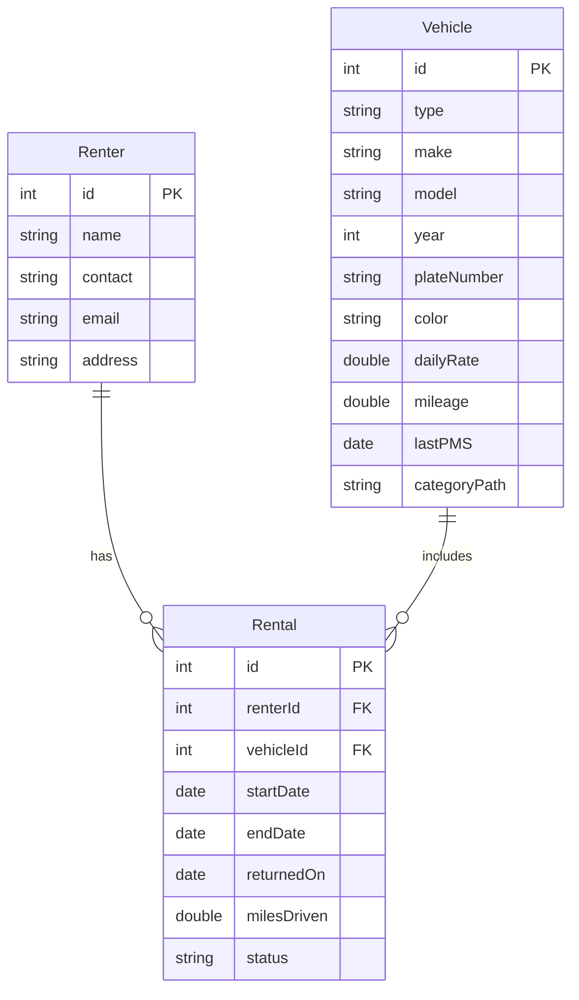

# FleetRent: Vehicle Rental & Fleet Management System

## Project Design Document

CPE 314 - Software Design | University of Cebu Computer Engineering Department | Instructor: Richyll Son | First Semester, S.Y. 2026-2027

| Item                    | Details                                                                           |
| ----------------------- | --------------------------------------------------------------------------------- |
| Group Name / No.        | Group 4                                                                           |
| Members                 | Gabasa, Dexter; Rosal, Wendil; Coloscos, Brent; Lagaya, John Carlo; Labra, Simone |
| Repository URL          | https://github.com/ColoscosBrent/cpe314-69323-capstone-team-04                    |
| Instructor              | Richyll Son                                                                       |
| Term                    | First Semester, S.Y. 2026-2027                                                    |
| Document Version / Date | 0.1 / October 21, 2026                                                            |

## Revision History

# Revision History

**Table 1: Revision History of This Document**

| Version | Date | Author | Changes |
|---|---|---|---|
| 0.1 | October 21, 2026 | Team 4 | Initial draft — Week 8 sections |
| 0.2 | — | — | Week 9 sections added |
| 0.3 | — | — | Week 10 sections added |
| 1.0 | — | — | Final compilation and polish — Week 11 |
			

## 1. Introduction & Project Overview

FleetRent is a JavaFX desktop app that helps small shops renting out cars, SUVs, and motorcycles replace their paper logbooks, which make it easy to lose track of which vehicle is out, its mileage, and who is next in line. It stores vehicles, renters, and rentals together in a single SQLite database, so staff can check vehicles out and in, look up rental history by renter or vehicle, and undo the last check-out if they make a mistake. When a vehicle is already rented, the app keeps a waiting list so the next customer is served in order, and it pulls verified make and model data from the NHTSA vPIC API instead of relying on typed-in entries. A dashboard then shows the most rented vehicle type and how busy the fleet is over time, giving owners a clear, organized view of their business.

# 2. Preliminary ER Sketch & Team Roles

This is the preliminary ER sketch from our Week 8 project proposal. It has three entities (Renter, Vehicle, and Rental) and two relationships. Tables 2 to 4 list the attributes of each entity, and Figure 1 shows how they connect. It is a rough draft and will be replaced by the finalized ERD in Section 4.

## Table 2: Renter Entity (Preliminary Attributes)

| Attribute | Key | Description |
|---|---|---|
| `id` | PK | Unique number for each renter. |
| `name` | - | Full name of the renter. |
| `contact` | - | Phone number of the renter. |
| `email` | - | Email address of the renter. |
| `address` | - | Home address of the renter. |

## Table 3: Vehicle Entity (Preliminary Attributes)

| Attribute | Key | Description |
|---|---|---|
| `id` | PK | Unique number for each vehicle. |
| `type` | - | SEDAN, SUV, or MOTORCYCLE. |
| `make` | - | Brand of the vehicle (from the NHTSA vPIC API). |
| `model` | - | Model name of the vehicle (from the NHTSA vPIC API). |
| `year` | - | Model year of the vehicle. |
| `plateNumber` | - | License plate number of the vehicle. |
| `color` | - | Color of the vehicle. |
| `dailyRate` | - | Rental price per day. |
| `mileage` | - | Total miles the vehicle has driven so far. |
| `lastPMS` | - | Date of the last preventive maintenance service (PMS). |
| `categoryPath` | - | Category text such as `Car > Sedan > Compact Sedan`, used to build the category tree. |

## Table 4: Rental Entity (Preliminary Attributes)

| Attribute | Key | Description |
|---|---|---|
| `id` | PK | Unique number for each rental. |
| `renterId` | FK | Links to `Renter.id` (who rented). |
| `vehicleId` | FK | Links to `Vehicle.id` (what was rented). |
| `startDate` | - | Day the rental starts (rent from). |
| `endDate` | - | Day the vehicle is due back (rent to). |
| `returnedOn` | - | Day the vehicle was actually returned to the rental shop. Empty until it is returned. |
| `milesDriven` | - | Miles driven during this rental (mileage used). |
| `status` | - | `ONGOING` or `RETURNED`. If the vehicle comes back earlier than `endDate`, the status becomes `RETURNED` and the vehicle is available to rent again. |

## Relationships

One Renter can have many Rentals (1:M), and one Vehicle can be in many Rentals over time (1:M). The Rental table connects a renter to a vehicle.

The Queue (waiting list) and the Stack (undo) are kept in memory only, so they are not tables. `categoryPath` is a text such as `Car > Sedan > Compact Sedan` that we use to build the vehicle category tree in code.

When a vehicle is returned, even earlier than its `endDate`, the rental status becomes `RETURNED` and the vehicle is available to rent again.

## Figure 1: Preliminary ER Sketch of FleetRent (Renter, Rental, Vehicle)

## Team Roster and Primary Roles

Each member has one role and one main job for Milestone 1, the same as in our project proposal.

### Table 5: Team Roster and Primary Roles (Group 4)

| Member (GitHub Username) | Role | Primary Responsibility |
|---|---|---|
| Gabasa, Dexter (`gabasad84-afk`) | DB | Database: SQLite tables for vehicles, renters, and rentals, and the JDBC code with `PreparedStatement`. Database tests. |
| Rosal, Wendil (`wendilrosalx22`) | ADMIN, QA | Vehicle category tree and the recursive fleet mileage method. Maven project setup. Tests for these. |
| Coloscos, Brent (`ColoscosBrent`) | TEAM LEAD, DEVELOPER | Domain model and OOD: abstract `Vehicle` class, its three subclasses, and the rate and fee logic. Tests for these. |
| Lagaya, John Carlo (`caloylagaya2k4-pixel`) | DEVELOPER | Rental and Renter classes, the waiting list Queue, the undo Stack, and the CSV import on a background thread. Tests for these. |
| Labra, Simone (`simonelabra21`) | UI | NHTSA vPIC API: sending requests and parsing JSON. JavaFX GUI (forms, buttons, dashboard) and the bar and line charts. |
| **All members** | - | Commit our own work to the team repo, review each other's pull requests, and attend the Week 8–9 consultation. |

## 3. System Architecture & Object-Oriented Design

_To be completed in Week 9._

## 4. Data Model & Database Design

_To be completed in Week 9._

## 5. API Integration Design

_To be completed in Week 9._

## 6. Concurrency Design

_To be completed in Week 10._

## 7. Data Mining & Visualization Design

_To be completed in Week 10._

## 8. Testing Summary

_To be completed in Week 10._

## 9. Individual Contributions

_To be completed in Week 11._

## Appendix

_To be completed in Week 11._
