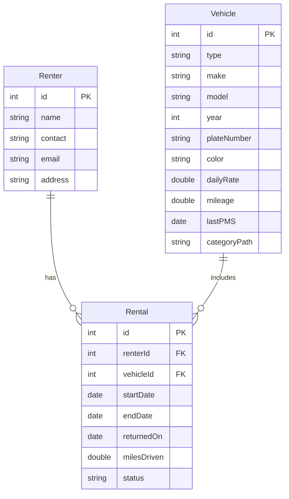
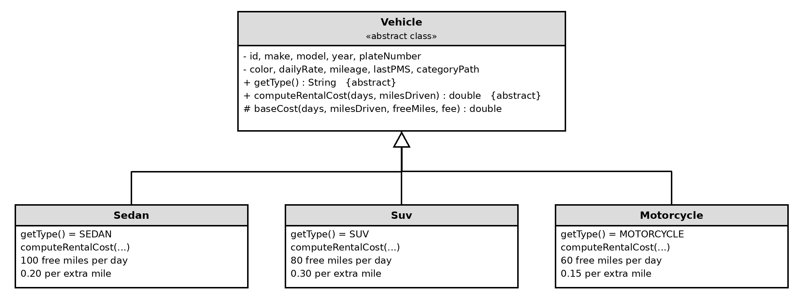
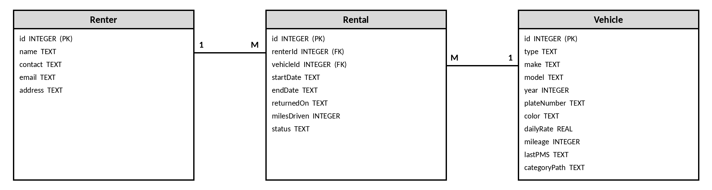

# FleetRent: Vehicle Rental & Fleet Management System

## Project Design Document

CPE 314 - Software Design | University of Cebu Computer Engineering Department | Instructor: Richyll Son | First Semester, S.Y. 2026-2027

| Item                    | Details                                                                           |
| ----------------------- | --------------------------------------------------------------------------------- |
| Group Name / No.        | Group 4                                                                           |
| Members                 | Gabasa, Dexter; Rosal, Wendil; Coloscos, Brent; Lagaya, John Carlo; Labra, Simone |
| Repository URL          | https://github.com/ColoscosBrent/cpe314-69323-capstone-team-04                    |
| Instructor              | Richyll Son                                                                       |
| Term                    | First Semester, S.Y. 2026-2027                                                    |
| Document Version / Date | 0.2 / October 27, 2026                                                            |

## Revision History


**Table 1: Revision History of This Document**

| Version | Date | Author | Changes |
|---|---|---|---|
| 0.1 | October 21, 2026 | Team 4 | Initial draft — Week 8 sections |
| 0.2 | October 27, 2026 | Team 4 | Week 9 sections added — Section 3 (OOD) and Section 4 (Data Model) |
| 0.3 | — | — | Week 10 sections added |
| 1.0 | — | — | Final compilation and polish — Week 11 |

## 1. Introduction & Project Overview

FleetRent is a JavaFX desktop app that helps small shops renting out cars, SUVs, and motorcycles replace their paper logbooks, which make it easy to lose track of which vehicle is out, its mileage, and who is next in line. It stores vehicles, renters, and rentals together in a single SQLite database, so staff can check vehicles out and in, look up rental history by renter or vehicle, and undo the last check-out if they make a mistake. When a vehicle is already rented, the app keeps a waiting list so the next customer is served in order, and it pulls verified make and model data from the NHTSA vPIC API instead of relying on typed-in entries. A dashboard then shows the most rented vehicle type and how busy the fleet is over time, giving owners a clear, organized view of their business.


## 2. Preliminary ER Sketch & Team Roles

This is the preliminary ER sketch from our Week 8 project proposal. It has three entities (Renter, Vehicle, and Rental) and two relationships. Tables 2 to 4 list the attributes of each entity, and Figure 1 shows how they connect. It is a rough draft and will be replaced by the finalized ERD in Section 4.

## Table 2: Renter Entity (Preliminary Attributes)

| Attribute | Key | Description |
|---|---|---|
| `id` | PK | Unique number for each renter. |
| `name` | - | Full name of the renter. |
| `contact` | - | Phone number of the renter. |
| `email` | - | Email address of the renter. |
| `address` | - | Home address of the renter. |

## Table 3: Vehicle Entity (Preliminary Attributes)

| Attribute | Key | Description |
|---|---|---|
| `id` | PK | Unique number for each vehicle. |
| `type` | - | SEDAN, SUV, or MOTORCYCLE. |
| `make` | - | Brand of the vehicle (from the NHTSA vPIC API). |
| `model` | - | Model name of the vehicle (from the NHTSA vPIC API). |
| `year` | - | Model year of the vehicle. |
| `plateNumber` | - | License plate number of the vehicle. |
| `color` | - | Color of the vehicle. |
| `dailyRate` | - | Rental price per day. |
| `mileage` | - | Total miles the vehicle has driven so far. |
| `lastPMS` | - | Date of the last preventive maintenance service (PMS). |
| `categoryPath` | - | Category text such as `Car > Sedan > Compact Sedan`, used to build the category tree. |

## Table 4: Rental Entity (Preliminary Attributes)

| Attribute | Key | Description |
|---|---|---|
| `id` | PK | Unique number for each rental. |
| `renterId` | FK | Links to `Renter.id` (who rented). |
| `vehicleId` | FK | Links to `Vehicle.id` (what was rented). |
| `startDate` | - | Day the rental starts (rent from). |
| `endDate` | - | Day the vehicle is due back (rent to). |
| `returnedOn` | - | Day the vehicle was actually returned to the rental shop. Empty until it is returned. |
| `milesDriven` | - | Miles driven during this rental (mileage used). |
| `status` | - | `ONGOING` or `RETURNED`. If the vehicle comes back earlier than `endDate`, the status becomes `RETURNED` and the vehicle is available to rent again. |

## Relationships

One Renter can have many Rentals (1:M), and one Vehicle can be in many Rentals over time (1:M). The Rental table connects a renter to a vehicle.

The Queue (waiting list) and the Stack (undo) are kept in memory only, so they are not tables. `categoryPath` is a text such as `Car > Sedan > Compact Sedan` that we use to build the vehicle category tree in code.

When a vehicle is returned, even earlier than its `endDate`, the rental status becomes `RETURNED` and the vehicle is available to rent again.

## Figure 1: Preliminary ER Sketch of FleetRent (Renter, Rental, Vehicle)



## Team Roster and Primary Roles

Each member has one role and one main job for Milestone 1, the same as in our project proposal.

## Table 5: Team Roster and Primary Roles (Group 4)

| Member (GitHub Username) | Role | Primary Responsibility |
|---|---|---|
| Gabasa, Dexter (`gabasad84-afk`) | DB | Database: SQLite tables for vehicles, renters, and rentals, and the JDBC code with `PreparedStatement`. Database tests. |
| Rosal, Wendil (`wendilrosalx22`) | ADMIN, QA | Vehicle category tree and the recursive fleet mileage method. Maven project setup. Tests for these. |
| Coloscos, Brent (`ColoscosBrent`) | TEAM LEAD, DEVELOPER | Domain model and OOD: abstract `Vehicle` class, its three subclasses, and the rate and fee logic. Tests for these. |
| Lagaya, John Carlo (`caloylagaya2k4-pixel`) | DEVELOPER | Rental and Renter classes, the waiting list Queue, the undo Stack, and the CSV import on a background thread. Tests for these. |
| Labra, Simone (`simonelabra21`) | UI | NHTSA vPIC API: sending requests and parsing JSON. JavaFX GUI (forms, buttons, dashboard) and the bar and line charts. |
| **All members** | - | Commit our own work to the team repo, review each other's pull requests, and attend the Week 8–9 consultation. |

## 3. System Architecture & Object-Oriented Design

FleetRent is split into four parts: the model classes (vehicles, renters, rentals), the in-memory data structures (waiting list, undo stack, category tree), the Database class that talks to SQLite, and the JavaFX window. The window never writes SQL, and the Database class never touches the window.

### 3.1 Class Hierarchy



Figure 2: Class hierarchy of FleetRent (Vehicle and its three subclasses)

`Vehicle` is an abstract class. It holds the data every vehicle has (make, model, year, plate number, color, daily rate, mileage, last PMS date, category path) and has two abstract methods: `getType()` and `computeRentalCost(days, milesDriven)`. `Sedan`, `Suv`, and `Motorcycle` extend it. Each one answers `getType()` with its own type and has its own mileage fee rule (Table 6):

**Table 6: Mileage Fee Rule of Each Vehicle Subclass**

| Subclass | Type text | Free miles per day | Fee per extra mile |
|---|---|---|---|
| Sedan | SEDAN | 100 | 0.20 |
| Suv | SUV | 80 | 0.30 |
| Motorcycle | MOTORCYCLE | 60 | 0.15 |

These numbers are our current rules and can still change.

The hierarchy is used polymorphically while the app runs. The window and the database code hold plain `Vehicle` references. When the app calls `computeRentalCost(...)` on one, Java runs the `Sedan`, `Suv`, or `Motorcycle` version at runtime. `VehicleFactory` creates the right subclass from the type text stored in the database.

The other classes are not part of this hierarchy:

- `CategoryNode`: one box in the category tree (Car > Sedan > Compact Sedan). Its recursive `totalMileage()` adds up the mileage of a box and everything below it.
- `Renter`, `Rental`, `RentalStatus`: the data for a customer and a rental (ONGOING or RETURNED).
- `WaitingList`: a Queue of renters waiting for a vehicle (first in, first out).
- `CheckoutHistory`: a Stack of check-outs so the last one can be undone (last in, first out).
- `Database`: all SQLite code, using JDBC `PreparedStatement`.
- `App` and `Main`: the JavaFX window and the class that starts it.

### 3.2 Single Responsibility Principle

Table 7 explains, for each class, its one responsibility and why that follows the Single Responsibility Principle (SRP): each class has one reason to change.

**Table 7: SRP Justification for Each Class**

| Class | Its one responsibility | Why this follows SRP |
|---|---|---|
| Vehicle | Holds the shared vehicle data and defines what every vehicle must be able to do | It does not save to the database or draw anything. It only describes a vehicle. |
| Sedan | The rental cost rule of a sedan | Only a change in the sedan fee rule changes this class. |
| Suv | The rental cost rule of an SUV | Only a change in the SUV fee rule changes this class. |
| Motorcycle | The rental cost rule of a motorcycle | Only a change in the motorcycle fee rule changes this class. |
| VehicleFactory | Creating the correct Vehicle subclass from a type text | Adding a new vehicle type changes this class, and no other class has to know how objects are created. |
| CategoryNode | The category tree and the recursive mileage total | It knows about categories and mileage only, not about rentals or the database. |
| Renter | The data of one renter | It only stores renter information. |
| Rental | The data of one rental and marking it as returned | It does not decide prices and does not save itself. |
| RentalStatus | The allowed rental states | It only lists ONGOING and RETURNED. |
| WaitingList | The waiting line of renters | It only manages the queue order. |
| CheckoutHistory | The undo stack of check-outs | It only manages the undo order. |
| Database | Reading and writing SQLite | It is the only class that contains SQL. If the database changes, only this class changes. |
| App | The JavaFX window and button handlers | It shows data and passes user actions on. It does not contain SQL or cost rules. |
| Main | Starting the JavaFX application | It only launches `App`. |

## 4. Data Model & Database Design

### 4.1 Finalized ERD

This is the finalized ERD of FleetRent. It replaces the preliminary sketch from Week 8. It has the same three entities, now with data types. The labels 1 and M show the cardinality: one Renter to many Rentals, and one Vehicle to many Rentals. One Renter can have many Rentals (1 to M), and one Vehicle can be in many Rentals over time (1 to M). The Rental table connects a renter to a vehicle through two foreign keys.



Figure 3: Finalized ERD of FleetRent (Renter, Rental, Vehicle)

The waiting list Queue and the undo Stack live in memory only, so they are not tables. The category tree is built in code from the `categoryPath` text of each vehicle.

### 4.2 Schema Description

The SQLite database file is `fleetrent.db`. The app creates it and the three tables the first time it runs, using the CREATE TABLE statements below (they are also saved in `src/main/resources/schema.sql`). They match the finalized ERD in Figure 3.

```sql
CREATE TABLE IF NOT EXISTS Renter (
    id       INTEGER PRIMARY KEY AUTOINCREMENT,
    name     TEXT NOT NULL,
    contact  TEXT,
    email    TEXT,
    address  TEXT
);

CREATE TABLE IF NOT EXISTS Vehicle (
    id            INTEGER PRIMARY KEY AUTOINCREMENT,
    type          TEXT NOT NULL CHECK (type IN ('SEDAN', 'SUV', 'MOTORCYCLE')),
    make          TEXT NOT NULL,
    model         TEXT NOT NULL,
    year          INTEGER,
    plateNumber   TEXT,
    color         TEXT,
    dailyRate     REAL NOT NULL,
    mileage       INTEGER NOT NULL DEFAULT 0,
    lastPMS       TEXT,
    categoryPath  TEXT
);

CREATE TABLE IF NOT EXISTS Rental (
    id           INTEGER PRIMARY KEY AUTOINCREMENT,
    renterId     INTEGER NOT NULL REFERENCES Renter(id),
    vehicleId    INTEGER NOT NULL REFERENCES Vehicle(id),
    startDate    TEXT NOT NULL,
    endDate      TEXT NOT NULL,
    returnedOn   TEXT,
    milesDriven  INTEGER NOT NULL DEFAULT 0,
    status       TEXT NOT NULL DEFAULT 'ONGOING' CHECK (status IN ('ONGOING', 'RETURNED'))
);
```

Notes on the schema:

- Dates (`lastPMS`, `startDate`, `endDate`, `returnedOn`) are saved as text in the form `YYYY-MM-DD`, because SQLite has no separate date type.
- `returnedOn` stays empty (NULL) until the vehicle is returned. When a vehicle comes back, even before `endDate`, the status changes to RETURNED and the vehicle can be rented again.
- `Rental.renterId` and `Rental.vehicleId` are foreign keys. The app turns on `PRAGMA foreign_keys = ON`, so SQLite refuses a rental that points to a renter or vehicle that does not exist.
- `Vehicle.type` is limited to SEDAN, SUV, or MOTORCYCLE.
- All JDBC statements that use values use `PreparedStatement` with bound parameters.

## 5. API Integration Design

_To be completed in Week 9._

## 6. Concurrency Design

_To be completed in Week 10._

## 7. Data Mining & Visualization Design

_To be completed in Week 10._

## 8. Testing Summary

_To be completed in Week 10._

## 9. Individual Contributions

_To be completed in Week 11._

## Appendix

_To be completed in Week 11._
