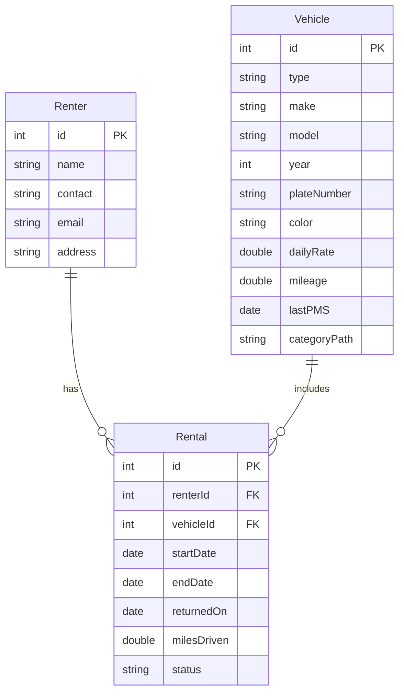

# FleetRent: Vehicle Rental & Fleet Management System

## Project Design Document

CPE 314 - Software Design | University of Cebu Computer Engineering Department | Instructor: Richyll Son | First Semester, S.Y. 2026-2027

| Item                    | Details                                                                           |
| ----------------------- | --------------------------------------------------------------------------------- |
| Group Name / No.        | Group 4                                                                           |
| Members                 | Gabasa, Dexter; Rosal, Wendil; Coloscos, Brent; Lagaya, John Carlo; Labra, Simone |
| Repository URL          | https://github.com/ColoscosBrent/cpe314-69323-capstone-team-04                    |
| Instructor              | Richyll Son                                                                       |
| Term                    | First Semester, S.Y. 2026-2027                                                    |
| Document Version / Date | 0.3 / November 2, 2026                                                            |

## Revision History


**Table 1: Revision History of This Document**

| Version | Date | Author | Changes |
|---|---|---|---|
| 0.1 | October 21, 2026 | Team 4 | Initial draft — Week 8 sections |
| 0.2 | October 27, 2026 | Team 4 | Week 9 sections added — Section 3 (OOD) and Section 4 (Data Model) |
| 0.3 | November 2, 2026 | Team 4 | Week 10 sections added — Section 5 (API), Section 6 (Concurrency), Section 7 (Data Mining & Visualization), Section 8 (Testing Summary) |
| 1.0 | — | — | Final compilation and polish — Week 11 |

## 1. Introduction & Project Overview

FleetRent is a JavaFX desktop app that helps small shops renting out cars, SUVs, and motorcycles replace their paper logbooks, which make it easy to lose track of which vehicle is out, its mileage, and who is next in line. It stores vehicles, renters, and rentals together in a single SQLite database, so staff can check vehicles out and in, look up rental history by renter or vehicle, and undo the last check-out if they make a mistake. When a vehicle is already rented, the app keeps a waiting list so the next customer is served in order, and it pulls verified make and model data from the NHTSA vPIC API instead of relying on typed-in entries. A dashboard then shows the most rented vehicle type and how busy the fleet is over time, giving owners a clear, organized view of their business.


## 2. Preliminary ER Sketch & Team Roles

This is the preliminary ER sketch from our Week 8 project proposal. It has three entities (Renter, Vehicle, and Rental) and two relationships. Tables 2 to 4 list the attributes of each entity, and Figure 1 shows how they connect. It is a rough draft and will be replaced by the finalized ERD in Section 4.

## Table 2: Renter Entity (Preliminary Attributes)

| Attribute | Key | Description |
|---|---|---|
| `id` | PK | Unique number for each renter. |
| `name` | - | Full name of the renter. |
| `contact` | - | Phone number of the renter. |
| `email` | - | Email address of the renter. |
| `address` | - | Home address of the renter. |

## Table 3: Vehicle Entity (Preliminary Attributes)

| Attribute | Key | Description |
|---|---|---|
| `id` | PK | Unique number for each vehicle. |
| `type` | - | SEDAN, SUV, or MOTORCYCLE. |
| `make` | - | Brand of the vehicle (from the NHTSA vPIC API). |
| `model` | - | Model name of the vehicle (from the NHTSA vPIC API). |
| `year` | - | Model year of the vehicle. |
| `plateNumber` | - | License plate number of the vehicle. |
| `color` | - | Color of the vehicle. |
| `dailyRate` | - | Rental price per day. |
| `mileage` | - | Total miles the vehicle has driven so far. |
| `lastPMS` | - | Date of the last preventive maintenance service (PMS). |
| `categoryPath` | - | Category text such as `Car > Sedan > Compact Sedan`, used to build the category tree. |

## Table 4: Rental Entity (Preliminary Attributes)

| Attribute | Key | Description |
|---|---|---|
| `id` | PK | Unique number for each rental. |
| `renterId` | FK | Links to `Renter.id` (who rented). |
| `vehicleId` | FK | Links to `Vehicle.id` (what was rented). |
| `startDate` | - | Day the rental starts (rent from). |
| `endDate` | - | Day the vehicle is due back (rent to). |
| `returnedOn` | - | Day the vehicle was actually returned to the rental shop. Empty until it is returned. |
| `milesDriven` | - | Miles driven during this rental (mileage used). |
| `status` | - | `ONGOING` or `RETURNED`. If the vehicle comes back earlier than `endDate`, the status becomes `RETURNED` and the vehicle is available to rent again. |

## Relationships

One Renter can have many Rentals (1:M), and one Vehicle can be in many Rentals over time (1:M). The Rental table connects a renter to a vehicle.

The Queue (waiting list) and the Stack (undo) are kept in memory only, so they are not tables. `categoryPath` is a text such as `Car > Sedan > Compact Sedan` that we use to build the vehicle category tree in code.

When a vehicle is returned, even earlier than its `endDate`, the rental status becomes `RETURNED` and the vehicle is available to rent again.

## Figure 1: Preliminary ER Sketch of FleetRent (Renter, Rental, Vehicle)



## Team Roster and Primary Roles

Each member has one role and one main job for Milestone 1, the same as in our project proposal.

## Table 5: Team Roster and Primary Roles (Group 4)

| Member (GitHub Username) | Role | Primary Responsibility |
|---|---|---|
| Gabasa, Dexter (`gabasad84-afk`) | DB | Database: SQLite tables for vehicles, renters, and rentals, and the JDBC code with `PreparedStatement`. Database tests. |
| Rosal, Wendil (`wendilrosalx22`) | ADMIN, QA | Vehicle category tree and the recursive fleet mileage method. Maven project setup. Tests for these. |
| Coloscos, Brent (`ColoscosBrent`) | TEAM LEAD, DEVELOPER | Domain model and OOD: abstract `Vehicle` class, its three subclasses, and the rate and fee logic. Tests for these. |
| Lagaya, John Carlo (`caloylagaya2k4-pixel`) | DEVELOPER | Rental and Renter classes, the waiting list Queue, the undo Stack, and the CSV import on a background thread. Tests for these. |
| Labra, Simone (`simonelabra21`) | UI | NHTSA vPIC API: sending requests and parsing JSON. JavaFX GUI (forms, buttons, dashboard) and the bar and line charts. |
| **All members** | - | Commit our own work to the team repo, review each other's pull requests, and attend the Week 8–9 consultation. |

## 3. System Architecture & Object-Oriented Design

FleetRent is split into four parts: the model classes (vehicles, renters, rentals), the in-memory data structures (waiting list, undo stack, category tree), the Database class that talks to SQLite, and the JavaFX window. The window never writes SQL, and the Database class never touches the window.

### 3.1 Class Hierarchy


Figure 2: Class hierarchy of FleetRent (Vehicle and its three subclasses)

`Vehicle` is an abstract class. It holds the data every vehicle has (make, model, year, plate number, color, daily rate, mileage, last PMS date, category path) and has two abstract methods: `getType()` and `computeRentalCost(days, milesDriven)`. `Sedan`, `Suv`, and `Motorcycle` extend it. Each one answers `getType()` with its own type and has its own mileage fee rule (Table 6):

**Table 6: Mileage Fee Rule of Each Vehicle Subclass**

| Subclass | Type text | Free miles per day | Fee per extra mile |
|---|---|---|---|
| Sedan | SEDAN | 100 | 0.20 |
| Suv | SUV | 80 | 0.30 |
| Motorcycle | MOTORCYCLE | 60 | 0.15 |

These numbers are our current rules and can still change.

The hierarchy is used polymorphically while the app runs. The window and the database code hold plain `Vehicle` references. When the app calls `computeRentalCost(...)` on one, Java runs the `Sedan`, `Suv`, or `Motorcycle` version at runtime. `VehicleFactory` creates the right subclass from the type text stored in the database.

The other classes are not part of this hierarchy:

- `CategoryNode`: one box in the category tree (Car > Sedan > Compact Sedan). Its recursive `totalMileage()` adds up the mileage of a box and everything below it.
- `Renter`, `Rental`, `RentalStatus`: the data for a customer and a rental (ONGOING or RETURNED).
- `WaitingList`: a Queue of renters waiting for a vehicle (first in, first out).
- `CheckoutHistory`: a Stack of check-outs so the last one can be undone (last in, first out).
- `Database`: all SQLite code, using JDBC `PreparedStatement`.
- `App` and `Main`: the JavaFX window and the class that starts it.

### 3.2 Single Responsibility Principle

Table 7 explains, for each class, its one responsibility and why that follows the Single Responsibility Principle (SRP): each class has one reason to change.

**Table 7: SRP Justification for Each Class**

| Class | Its one responsibility | Why this follows SRP |
|---|---|---|
| Vehicle | Holds the shared vehicle data and defines what every vehicle must be able to do | It does not save to the database or draw anything. It only describes a vehicle. |
| Sedan | The rental cost rule of a sedan | Only a change in the sedan fee rule changes this class. |
| Suv | The rental cost rule of an SUV | Only a change in the SUV fee rule changes this class. |
| Motorcycle | The rental cost rule of a motorcycle | Only a change in the motorcycle fee rule changes this class. |
| VehicleFactory | Creating the correct Vehicle subclass from a type text | Adding a new vehicle type changes this class, and no other class has to know how objects are created. |
| CategoryNode | The category tree and the recursive mileage total | It knows about categories and mileage only, not about rentals or the database. |
| Renter | The data of one renter | It only stores renter information. |
| Rental | The data of one rental and marking it as returned | It does not decide prices and does not save itself. |
| RentalStatus | The allowed rental states | It only lists ONGOING and RETURNED. |
| WaitingList | The waiting line of renters | It only manages the queue order. |
| CheckoutHistory | The undo stack of check-outs | It only manages the undo order. |
| Database | Reading and writing SQLite | It is the only class that contains SQL. If the database changes, only this class changes. |
| App | The JavaFX window and button handlers | It shows data and passes user actions on. It does not contain SQL or cost rules. |
| Main | Starting the JavaFX application | It only launches `App`. |

## 4. Data Model & Database Design

### 4.1 Finalized ERD

This is the finalized ERD of FleetRent. It replaces the preliminary sketch from Week 8. It has the same three entities, now with data types. The labels 1 and M show the cardinality: one Renter to many Rentals, and one Vehicle to many Rentals. One Renter can have many Rentals (1 to M), and one Vehicle can be in many Rentals over time (1 to M). The Rental table connects a renter to a vehicle through two foreign keys.


Figure 3: Finalized ERD of FleetRent (Renter, Rental, Vehicle)

The waiting list Queue and the undo Stack live in memory only, so they are not tables. The category tree is built in code from the `categoryPath` text of each vehicle.

### 4.2 Schema Description

The SQLite database file is `fleetrent.db`. The app creates it and the three tables the first time it runs, using the CREATE TABLE statements below (they are also saved in `src/main/resources/schema.sql`). They match the finalized ERD in Figure 3.

```sql
CREATE TABLE IF NOT EXISTS Renter (
    id       INTEGER PRIMARY KEY AUTOINCREMENT,
    name     TEXT NOT NULL,
    contact  TEXT,
    email    TEXT,
    address  TEXT
);

CREATE TABLE IF NOT EXISTS Vehicle (
    id            INTEGER PRIMARY KEY AUTOINCREMENT,
    type          TEXT NOT NULL CHECK (type IN ('SEDAN', 'SUV', 'MOTORCYCLE')),
    make          TEXT NOT NULL,
    model         TEXT NOT NULL,
    year          INTEGER,
    plateNumber   TEXT,
    color         TEXT,
    dailyRate     REAL NOT NULL,
    mileage       INTEGER NOT NULL DEFAULT 0,
    lastPMS       TEXT,
    categoryPath  TEXT
);

CREATE TABLE IF NOT EXISTS Rental (
    id           INTEGER PRIMARY KEY AUTOINCREMENT,
    renterId     INTEGER NOT NULL REFERENCES Renter(id),
    vehicleId    INTEGER NOT NULL REFERENCES Vehicle(id),
    startDate    TEXT NOT NULL,
    endDate      TEXT NOT NULL,
    returnedOn   TEXT,
    milesDriven  INTEGER NOT NULL DEFAULT 0,
    status       TEXT NOT NULL DEFAULT 'ONGOING' CHECK (status IN ('ONGOING', 'RETURNED'))
);
```

Notes on the schema:

- Dates (`lastPMS`, `startDate`, `endDate`, `returnedOn`) are saved as text in the form `YYYY-MM-DD`, because SQLite has no separate date type.
- `returnedOn` stays empty (NULL) until the vehicle is returned. When a vehicle comes back, even before `endDate`, the status changes to RETURNED and the vehicle can be rented again.
- `Rental.renterId` and `Rental.vehicleId` are foreign keys. The app turns on `PRAGMA foreign_keys = ON`, so SQLite refuses a rental that points to a renter or vehicle that does not exist.
- `Vehicle.type` is limited to SEDAN, SUV, or MOTORCYCLE.
- All JDBC statements that use values use `PreparedStatement` with bound parameters.

## 5. API Integration Design

**API used.** FleetRent uses the free NHTSA vPIC (Vehicle Product Information Catalog) web service, a public REST API from the US National Highway Traffic Safety Administration. It needs no API key. Base address: `https://vpic.nhtsa.dot.gov/api`. We chose it because the app needs real make and model names for the Add Vehicle form instead of typed-in guesses. The catalog lists vehicles sold in the United States, so a few models are not sold in the Philippines. Our instructor approved this for the capstone.

**Endpoints called.** All are plain HTTP GET requests that return JSON (`?format=json`). The vehicle type words NHTSA understands are `car`, `mpv` (its name for SUVs) and `motorcycle`.

| Endpoint | When we use it |
|---|---|
| `/vehicles/GetMakesForVehicleType/{type}?format=json` | When the Type box of the Add Vehicle form is set (and every time it changes). It fills the Make list with the makes NHTSA has for that type, so a motorcycle make can never be picked for a Sedan. |
| `/vehicles/GetModelsForMakeYear/make/{make}/vehicleType/{type}?format=json` | After a make is clicked and the Year box says "Not specified". It fills the Model list. |
| `/vehicles/GetModelsForMakeYear/make/{make}/modelyear/{year}/vehicleType/{type}?format=json` | Same, when a Year is chosen. The API only has years after 1995, so the Year box starts at 1996. If NHTSA has no model for that make, type and year, the app asks again without the year, shows all years and sets Year back to "Not specified" with a note. |
| `/vehicles/GetModelsForMake/{make}?format=json` | The Dashboard question "NHTSA models per make in our fleet (live)", once for each make in the fleet. |

**Type, make and model always agree.** Our three types map to NHTSA types: SEDAN to `car`, SUV to `mpv`, MOTORCYCLE to `motorcycle` (class `VehicleTypes`). The Type box decides which lists are loaded, and Make and Model are chosen by clicking in those lists, not typed. The Category box only offers paths that belong to the chosen type. NHTSA does not give vehicle colors, so the Color box uses a fixed list of 17 color names (class `ColorNames`) and the drawn car and swatches follow it. Only if NHTSA cannot be reached are Make and Model typed by hand (letters, digits and a few symbols only), and the screen says so.

**Shape of the JSON response.** The answer is one JSON object. The part we use is the `Results` array. Each item describes one model:

```
{
  "Count": 3,
  "Message": "Response returned successfully",
  "SearchCriteria": "Make:toyota",
  "Results": [
    { "Make_ID": 448, "Make_Name": "TOYOTA", "Model_ID": 2208, "Model_Name": "Corolla" }
  ]
}
```

The makes answer has the same `Results` array, with `MakeId`, `MakeName`, `VehicleTypeId` and `VehicleTypeName` in each item.

**How the data is parsed.** The class `VpicClient` sends the request with Java's built-in `java.net.http.HttpClient` (HTTP/1.1, 10 second connect timeout, 30 second request timeout, follows redirects, uses the computer's proxy settings). The method `VpicClient.parseModels` reads the text with the Gson library and builds one `VehicleModelInfo` object (make name, model id, model name) for each item in `Results`. Items without a model name are skipped, and the final list is sorted by model name. `VpicClient.parseMakes` does the same for makes: it reads `MakeName`, removes duplicates and sorts the names. If the answer is not valid JSON or has no `Results` list, the method throws an error and the screen shows a plain message instead of crashing. A status code other than 200 is treated as a failure too. The class `ErrorMessages` turns each kind of failure into a clear sentence: no internet, the service took too long, could not connect (firewall or proxy), the service has a problem (HTTP 5xx), the service refused the request (HTTP 4xx), or an answer that cannot be read.

**How the data is used.** The parsed objects are not just printed. (1) They fill the Make and Model lists of the "Choose from NHTSA" card on the Vehicles tab. Clicking a make and a model puts them in the Add Vehicle form, and the vehicle saved in our SQLite database uses the official names. (2) The Dashboard question "NHTSA models per make in our fleet (live)" calls the API once for each make that exists in our fleet and charts how many models NHTSA lists for each make.

**No caching, and clear errors.** Every change of type, make or year makes a new live call, so the result always matches what NHTSA has at that moment. When NHTSA cannot be reached, the red message under "Choose from NHTSA" (or on the Dashboard) says why, the "Reload from NHTSA" button tries again, and the rest of the app keeps working. Each call also prints one line to the console (address, HTTP status, time taken) so the call can be shown during the demo. For a test or a demo the address can be changed with `-Dfleetrent.vpicUrl=http://...`.

**Second web service: car photos.** To show the real picture of each car, the app also calls the free Wikipedia web service (`https://en.wikipedia.org/w/api.php`, no key). The class `CarImageClient` asks for the page that matches "make model" and reads the `thumbnail.source` address from the JSON (`query.pages.*.thumbnail.source`, best search rank first). It then downloads that picture, `CarImageStore` checks that it really is a JPG, PNG, GIF or BMP and saves it as `vehicle_images/vehicle-<id>.<ext>`, and the Vehicles tab and the Rentals tab (ongoing and returned rentals) show it. This is a convenience feature, not one of the graded API calls. If Wikipedia has no picture, the network is down, or the user chose their own file with "Choose photo...", the app shows the picture the user chose or the drawn car in the vehicle's color instead, so the app never breaks. Our tests check the JSON reading and the saving with a fake local server; we did not verify the live Wikipedia answer inside our test environment, so this feature is checked by hand on a real computer before the demo.

## 6. Concurrency Design

**Long-running operations.** Four kinds of operation can take long enough to freeze a window, so each one runs on a background thread:

| Operation | Where | Why it is slow |
|---|---|---|
| NHTSA make and model lists | `VehicleTab.loadMakes`, `VehicleTab.loadModels` | They wait for the internet. |
| CSV rental import | `ImportTab.runImport` | It reads a file and writes thousands of rows to SQLite (the demo file has 50,000 rentals). |
| Car photo search (after adding a vehicle, and the "Find photos for all" button) | `VehicleTab.afterAdd`, `VehicleTab.findAllPhotos` | It asks Wikipedia and downloads pictures. |
| Live dashboard question | `DashboardTab.showLive` | It makes one API call for each make in the fleet. |

**Threading approach.** We use JavaFX `Task` objects. The slow work is written inside the Task's `call()` method. The helper `UiHelper.runInBackground` puts the Task on its own daemon thread (`new Thread(task)`), so the thread never keeps the program open after the window closes. We chose `Task` instead of a bare `Thread` because it reports its result in a safe way: when it finishes, `setOnSucceeded` or `setOnFailed` runs on the JavaFX Application Thread, so those handlers can update labels, lists and charts directly. During the CSV import, progress is sent to the window with `Platform.runLater`, which is the only way background code may touch the screen.

**How the UI stays responsive.** The Application Thread only draws the window and handles clicks. While a Task runs, the button that started it is disabled (so it cannot be pressed twice) and a `ProgressBar` is shown: an endless bar for API calls, and a bar that fills from 0 to 100 percent for the import. The user can switch to another tab, type in a form or press other buttons while the work continues. If the work fails, `setOnFailed` shows the message from `ErrorMessages` and turns the button back on. When the user changes the type or the make quickly, each request gets a number and an answer that is no longer the newest one is ignored, so an old answer can never overwrite a new list.

**Keeping the database safe.** The background import and the screen both use the same SQLite connection. Every public method in `Database` is `synchronized`, so two threads cannot use the connection at the same moment. The import saves rentals in batches of 100 inside one transaction (`insertRentalBatch`): if a batch fails, it is rolled back, and the transaction also makes the import much faster than saving row by row.

**Why not do it on the UI thread?** A call to NHTSA can take a second or more, and a 2,000-row import takes longer. On the UI thread the window would show "Not Responding" until it finished.

## 7. Data Mining & Visualization Design

**Data analyzed.** The Dashboard tab mines the rentals saved in our SQLite database (entered in the Rentals tab or imported from CSV) together with the vehicle table. Only rentals with status RETURNED are counted, because only they have a final cost. The class `FleetAnalytics` does all the calculations. It has no screen code, so it can be unit tested.

**Aggregation and frequency analysis.** The user picks a question and a date range (rentals that start inside the From and To dates are used):

| Question | Mining step |
|---|---|
| Most rented vehicle type | Frequency count: each returned rental is counted for the type of its vehicle (Sedan, SUV, Motorcycle). The biggest bar is the most rented type. |
| Fleet utilization per month (%) | Rate over time: for every month, the vehicle-days that were rented divided by (number of vehicles x days in the month), times 100. A vehicle counts once per day even if two records overlap, so it never passes 100%. |
| Revenue by vehicle type | Aggregation: for each rental, the cost is worked out with the vehicle's own `computeRentalCost`, then the costs are summed for Sedan, SUV and Motorcycle. |
| Rentals per month | Frequency count: rentals are grouped by year and month and counted. Months with no rentals show 0. |
| Top 5 rented models | Frequency count: rentals are counted per make and model, sorted from most to fewest, and cut to 5. |
| NHTSA models per make (live) | Count over live API data: the number of models NHTSA lists for each make in our fleet. |

A text summary line under the controls reports the number of rentals, total revenue, best earning type, busiest month and average rental length. A second analysis, `CategoryNode.totalMileage`, uses recursion over the vehicle category tree (Fleet > Car > Sedan) to total the mileage of every branch, and is shown as text under the chart.

**Nothing is hard-coded.** Every number comes from a database query. Changing a date, choosing another question, adding a rental or importing a new CSV changes both the summary and the chart. The unit tests also check that changing the date range changes the result.

**Charts.** We use two JavaFX charts, as the project description asks (a bar chart and a line chart). The `BarChart` shows questions that compare separate groups: most rented vehicle type, revenue by type, top 5 models and NHTSA models per make. The `LineChart` shows the two questions that change over time: rentals per month and fleet utilization per month. Both have a category axis (vehicle type, model, make or month) and a number axis (rentals, revenue, models or percent). The chart title and both axis labels change with the question. Only one series is drawn, so a legend would repeat the title and is hidden. Bars make it easy to compare groups at a glance, while a line shows the rise and fall from month to month. A pie chart would be hard to read for 12 months, so we do not use one.

## 8. Testing Summary

The project has 118 JUnit 5 tests. They run with `mvn test` and all pass with 0 errors, 0 failures. Tests that touch the database use an in-memory SQLite database (`jdbc:sqlite::memory:`), so they never change the real `fleetrent.db` file. The API tests use a small fake web server on the same computer, so they do not need the internet and always give the same answer.

| Test class | Tests | What it covers | Edge case examples |
|---|---|---|---|
| `VehicleCostTest` | 4 | Rental cost rules of Sedan, SUV, Motorcycle | Zero days is rejected, miles over the free limit |
| `CategoryNodeTest` | 3 | Recursive mileage totals | Empty tree, same category added twice |
| `QueueStackTest` | 4 | Waiting list (Queue) and check-out history (Stack) | Serving or undoing when empty |
| `DatabaseTest` | 6 | Insert and select for Renter, Vehicle, Rental | Rental with an unknown renter is rejected, vehicle without a model year is saved with an empty (NULL) year, renter without email and address |
| `MainTest` | 1 | Startup message | |
| `VpicClientTest` | 19 | Reading the NHTSA models and makes JSON, building the addresses with and without year and vehicle type, calling a fake server | Empty `Results`, missing model name, invalid JSON, HTTP 500, server down, blank make, year 1995, no vehicle type, duplicate makes |
| `RentalMathTest` | 4 | Billable days of a rental | Same-day rental counts as 1 day, end before start |
| `FleetAnalyticsTest` | 18 | Revenue per type, rentals per type, utilization per month, rentals per month, top models, average days | Empty data, From after To, ongoing rentals ignored, unknown vehicle, overlapping rentals, rental crossing a month end, no vehicles |
| `RentalServiceTest` | 9 | Start, return, waiting list and undo rules | Vehicle already rented, return twice, early return, negative miles |
| `RentalCsvImporterTest` | 6 | Checking CSV lines and saving them in batches | 9 kinds of bad line, empty file, header-only file, 450-row file |
| `SampleDataTest` | 5 | Demo data generator | Same seed gives the same file, zero rows |
| `CarImageStoreTest` | 6 | Saving, finding and replacing a car picture file | Text saved as a picture is rejected, empty bytes, missing file, wrong file name |
| `CarImageClientTest` | 9 | Reading the Wikipedia JSON, building the address, downloading and saving a picture with a fake server | No thumbnail, invalid JSON, HTTP 500, download that is not a picture, no picture found |
| `ValidatorsTest` | 8 | Which characters each text box accepts and when the finished text is valid | Letters in a phone box, digits in a name box, symbols in a plate, two @ in an email, 3 decimals in money, empty required and optional boxes |
| `ErrorMessagesTest` | 6 | The messages for API and database problems | No internet, timeout, connection refused, HTTP 503 and 404, unreadable answer, locked database file, missing record, no error given |
| `VehicleTypesTest` | 4 | Our types to NHTSA types, NHTSA names to our types, categories per type, vehicle name without a year | Unknown type, Truck is not supported, SUV with a Motorcycle category, year 0 |
| `ColorNamesTest` | 6 | Turning a color name into the color of the car picture | Upper case and spaces, "Pearl White", hex code, unknown, empty or null text |

## 9. Individual Contributions

_To be completed in Week 11._

## Appendix

_To be completed in Week 11._
