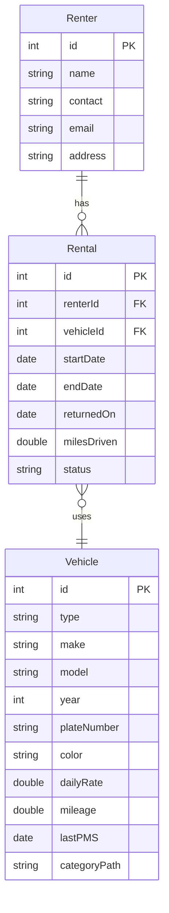

# Project Proposal - Team 04 (Group 4)

CPE 314 - Software Design | Week 8 | Instructor: Richyll Son | First Semester, S.Y. 2026-2027

| Item             | Details                                                                           |
| ---------------- | --------------------------------------------------------------------------------- |
| Group Name / No. | Group 4                                                                           |
| Members          | Gabasa, Dexter; Rosal, Wendil; Coloscos, Brent; Lagaya, John Carlo; Labra, Simone |
| Repository URL   | https://github.com/ColoscosBrent/cpe314-69323-capstone-team-04                    |
| Chosen Theme     | Q - Vehicle Rental & Fleet Management                                             |
| API You Will Use | NHTSA vPIC API - https://vpic.nhtsa.dot.gov/api                                   |

## 1. One-Paragraph Pitch

FleetRent is a JavaFX desktop application designed for small vehicle rental businesses that manage cars, SUVs, and motorcycles. It replaces paper logbooks with a centralized SQLite database for managing vehicles, renters, and rental records, while supporting check-out, check-in, rental history, and undo operations. The system maintains a waiting list when vehicles are unavailable and retrieves vehicle make and model information from the NHTSA vPIC API. Its dashboard displays the most-rented vehicle type and fleet utilization over time, helping business owners monitor rental activity and manage their fleet more efficiently.

# 2. Entity-Relationship Sketch

## Renter

| Attribute | Key | Description |
|---|---|---|
| `id` | PK | Unique number for each renter. |
| `name` | - | Full name of the renter. |
| `contact` | - | Phone number of the renter. |
| `email` | - | Email address of the renter. |
| `address` | - | Home address of the renter. |

## Vehicle

| Attribute | Key | Description |
|---|---|---|
| `id` | PK | Unique number for each vehicle. |
| `type` | - | SEDAN, SUV, or MOTORCYCLE. |
| `make` | - | Brand of the vehicle (from the NHTSA vPIC API). |
| `model` | - | Model name of the vehicle (from the NHTSA vPIC API). |
| `year` | - | Model year of the vehicle. |
| `plateNumber` | - | License plate number of the vehicle. |
| `color` | - | Color of the vehicle. |
| `dailyRate` | - | Rental price per day. |
| `mileage` | - | Total miles the vehicle has driven so far. |
| `lastPMS` | - | Date of the last preventive maintenance service (PMS). |
| `categoryPath` | - | Category text such as `Car > Sedan > Compact Sedan`, used to build the category tree. |

## Rental

| Attribute | Key | Description |
|---|---|---|
| `id` | PK | Unique number for each rental. |
| `renterId` | FK | Links to `Renter.id` (who rented). |
| `vehicleId` | FK | Links to `Vehicle.id` (what was rented). |
| `startDate` | - | Day the rental starts (rent from). |
| `endDate` | - | Day the vehicle is due back (rent to). |
| `returnedOn` | - | Day the vehicle was actually returned to the rental shop. Empty until it is returned. |
| `milesDriven` | - | Miles driven during this rental (mileage used). |
| `status` | - | `ONGOING` or `RETURNED`. If the vehicle comes back earlier than `endDate`, the status becomes `RETURNED` and the vehicle is available to rent again. |

## Relationships

- **Renter 1:M Rental:** One renter can have many rentals.
- **Vehicle 1:M Rental:** One vehicle can be in many rentals over time.

The Rental table connects a renter to a vehicle. The vehicle type is one of `SEDAN`, `SUV`, or `MOTORCYCLE`.

## Summary

We have 3 entities (Renter, Vehicle, Rental), all saved in SQLite using JDBC with `PreparedStatement`. The waiting-list Queue and the undo Stack are only in memory, not tables. `categoryPath` is a text like `Car > Sedan > Compact Sedan` that we use to build the vehicle category tree. When a vehicle is returned, even earlier than its `endDate`, the rental status becomes `RETURNED` and the vehicle is available to rent again.

## Figure 1: Preliminary ER Sketch of FleetRent (Renter, Rental, Vehicle)

### 3. Feature Checklist

| Planned Feature | Requirement(s) It Satisfies |
|---|---|
| Vehicle abstract class with Sedan, SUV, and Motorcycle subclasses. Each one has its own daily rate and mileage fee rules. | Object-Oriented Design |
| A Queue for the reservation waiting list and a Stack of check-outs so we can undo the last one. | Data Structure (Queue and Stack) |
| Vehicle category tree (Car > Sedan > Compact Sedan). A recursive method adds up the total fleet mileage. | Recursion |
| SQLite tables for Renter, Vehicle, and Rental, accessed with JDBC PreparedStatement. | Data Modeling + Database |
| Get make, model, and year data from the NHTSA vPIC API, parse the JSON, and use it when adding a vehicle. | API Consumption |
| Import the old rental history (CSV) using a JavaFX Task on a background thread, so the window does not freeze. | Concurrency |
| GUI with an add-vehicle form, check-out and check-in buttons, an undo button, an import button, and a dashboard tab. | Event-Driven GUI (3+ controls with handlers) |
| Dashboard: find the most rented vehicle type and the fleet utilization over time. Shown as a bar chart and a line chart with titles and axis labels. | Data Mining + Data Visualization |
| At least 6 JUnit 5 tests: rate and fee of each vehicle type, queue order, stack undo, recursive mileage (including an empty tree), and CSV edge cases. | Automated Testing |

### 4. Task Split

| Member | Role | Primary Responsibility (this milestone) |
|---|---|---|
| Gabasa, Dexter | DB | Database: SQLite tables for vehicles, renters, and rentals, and the JDBC code with `PreparedStatement`. Database tests. |
| Rosal, Wendil | ADMIN, QA | Vehicle category tree and the recursive fleet mileage method. Maven project setup. Tests for these. |
| Coloscos, Brent | TEAM LEAD, DEVELOPER | Domain model and OOD: `Vehicle` abstract class, its 3 subclasses, and the rate and fee logic. Tests for these. |
| Lagaya, John Carlo | DEVELOPER | Rental and Renter classes, the waiting list Queue, the undo Stack, and the CSV import on a background thread. Tests for these. |
| Labra, Simone | UI | NHTSA vPIC API: sending the request and parsing the JSON. JavaFX GUI (forms, buttons, dashboard) and the bar and line charts. |
| **All members** | - | Commit our own work to the team repo, review each other's pull requests, and attend the Week 8–9 consultation. |

### 5. Public API You Plan to Use
- **NHTSA vPIC API** (`https://vpic.nhtsa.dot.gov/api`). It gives real vehicle make, model, and year data from the US government in JSON. No API key needed.
- **Example call:** `https://vpic.nhtsa.dot.gov/api/vehicles/GetModelsForMake/honda?format=json`
- We will cache the response so we do not call the API too much.

### 6. Risks / Open Questions
- How will we keep the window responsive while importing a large rental history CSV?
- Should the category tree be saved as a text path in the Vehicle table or in its own table?
- How will we read the JSON from the API in Java, and is it OK to use a library like Gson?
- What should the app show when the API is slow or down?
- How will we count utilization over time correctly when rentals overlap?
